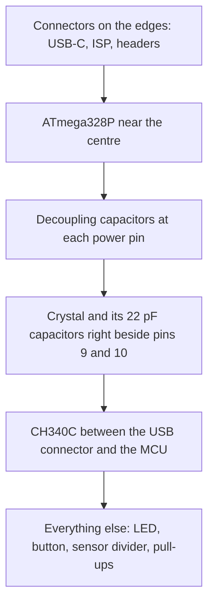

# Layout rules for microcontroller boards

The general layout rules from the PCB course still apply. Microcontroller boards add a few that make the difference between a board that runs reliably and one that crashes "randomly".

## Placement order



## Decoupling done right

Each 100 nF capacitor must form a **tiny loop** with its pin: capacitor → VCC pin, and capacitor → GND pin (or a via straight down to the ground pour), as short as possible.

```text
good:                         bad:
  VCC pin ── C ── via to GND    VCC pin ──────────────── C ── far away
  (a few mm)                    (the long track undoes the capacitor's job)
```

## The crystal

The crystal is the most sensitive part of the board:

- crystal and its two capacitors **within a few mm** of pins 9 and 10
- tracks short and direct; no other signals running between or under them
- solid ground under the crystal area; the capacitors' ground ends go straight to it

A badly placed crystal can still work on your desk and then fail to start when cold, or with a different crystal batch.

## Ground

Use a **solid ground pour** on the bottom layer, and keep it as unbroken as possible: every signal's current returns through the ground right under its track, and cuts in the pour force it to take a long detour (noise). Route most tracks on the top layer for that reason, and use short bottom-layer jumps only where needed. Add stitching vias between top and bottom ground areas.

## USB data lines

USB 2.0 full speed (what the CH340 uses) is forgiving, but good habits:

- route **D+ and D− together** as a pair, side by side, similar lengths, short
- keep them away from the crystal and other fast signals
- no stubs or test points hanging off them

## Power tracks

- +5V and GND tracks 0.5 mm or wider (or use the pour for GND).
- Route power from the connector to the capacitors first, then on to each chip.

## Make it easy to use and debug

- Label every header pin on the silkscreen (D2, A0, SDA, SCL, +5V, GND).
- Mark pin 1 of the ISP header and the chips clearly.
- Add **test points** (small pads) on +5V, GND, RESET, TX and RX: you'll want to put a meter or scope probe there.
- Put the reset button where a finger can reach it with the board in its case.
- Board name, version, date on the silkscreen.

## Final checks

Run the DRC, view the 3D model, print 1:1 to check the real DIP socket, USB-C connector and headers fit, and re-read the schematic checklist from the previous lesson. Then generate Gerbers, drill files, the BOM and (for factory assembly) the position file, exactly as in the PCB course.

## Summary

- Place connectors, then the MCU, then decoupling capacitors and the crystal hugging their pins.
- Keep a solid ground pour; route USB D+/D− as a short pair away from the crystal.
- Label everything, add test points, and run the usual DRC and 1:1 checks.

## Optional videos

The lesson above is complete on its own. These videos go deeper, if you like learning by watching.

**2-layer PCB design tips (Phil's Lab)**

https://www.youtube.com/watch?v=M6_an34wQJk
