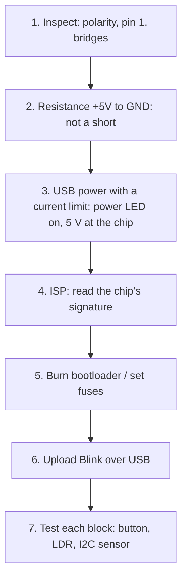

# Bring-up and debugging

Your boards arrived and you've soldered one. Bring it up in stages, so that when something is wrong you know exactly which stage failed.



## Stage by stage

**1 and 2: Before power.** Check chip orientation (the DIP socket's notch!), the USB-C connector's solder joints (bridges between its tiny pins are common), and measure +5V to GND: anything below about 100 Ω means a short.

**3: First power.** Use a USB port with a current-limited USB meter, or a bench supply at 5 V limited to 100 mA. The board should draw 10 to 40 mA. Measure 5 V at the ATmega's pin 7 and pin 20.

**4: ISP.** Connect the programmer and read the chip's **signature** (avrdude prints it):

```bash
avrdude -c usbasp -p m328p
```

```text
avrdude: Device signature = 0x1e950f (probably m328p)
```

A correct signature proves power, ground, reset, and the ISP pins all work. If it fails, check the ISP header orientation and the RESET pull-up first.

**5: Bootloader.** In the Arduino IDE: Tools → Programmer → USBasp (or "Arduino as ISP"), then **Tools → Burn Bootloader**. This also sets the fuses for the 16 MHz crystal, so the clock is now tested too.

**6: Upload over USB.** Select the CH340's port and upload Blink. If the upload times out, the usual suspects are: TX/RX swapped, the DTR capacitor missing, or the CH340 driver.

**7: Each block.** One small test sketch per feature: the button lights the LED, the LDR value changes when you cover it, the I²C sensor answers.

## The I²C scanner

A tiny sketch that lists every I²C device on the bus. If your sensor isn't found, it's a wiring, pull-up or power problem, not a code problem:

```cpp
#include <Wire.h>

void setup() {
  Wire.begin();
  Serial.begin(9600);
  for (byte addr = 1; addr < 127; addr++) {
    Wire.beginTransmission(addr);
    if (Wire.endTransmission() == 0) {
      Serial.print("found device at 0x");
      Serial.println(addr, HEX);
    }
  }
  Serial.println("scan done");
}

void loop() {}
```

## Common problems and causes

| Symptom | Likely cause |
|---|---|
| Nothing works, chip cold, no 5 V at pin 7 | power path: USB-C solder joints, polyfuse, missing CC resistors |
| ISP: "target doesn't answer" | ISP header reversed, RESET held low, no clock with crystal fuses set |
| Runs, but 16 times too slow | CKDIV8 fuse still set (burn the bootloader) |
| Upload "not in sync" | TX/RX swapped, no auto-reset capacitor, wrong board or port |
| Random resets | missing decoupling, floating RESET, weak USB supply |
| Analog readings jump around | AVCC not decoupled, AREF wrongly connected, noisy ground |

## Tools that help

- **Multimeter**: voltages, continuity (beep) to trace every net against the schematic.
- **Serial prints**: `Serial.println` at each step of your program.
- **USB power meter**: shows current draw at a glance.
- **Logic analyzer** (cheap 8-channel USB ones work with the free PulseView software): see serial, I²C and SPI signals as data.
- An **oscilloscope** if you can borrow one: see whether the crystal oscillates and how clean the 5 V is.

## Summary

- Bring up in stages: inspect, check shorts, current-limited power, ISP signature, bootloader, Blink, each block.
- The ISP signature proves power, reset and wiring; burning the bootloader proves the clock.
- Use a symptom table, serial prints, the I²C scanner and a multimeter to find faults fast.

## Optional videos

The lesson above is complete on its own. These videos go deeper, if you like learning by watching.

**Soldering tutorial, part 3: surface mount (EEVblog)**

https://www.youtube.com/watch?v=b9FC9fAlfQE
