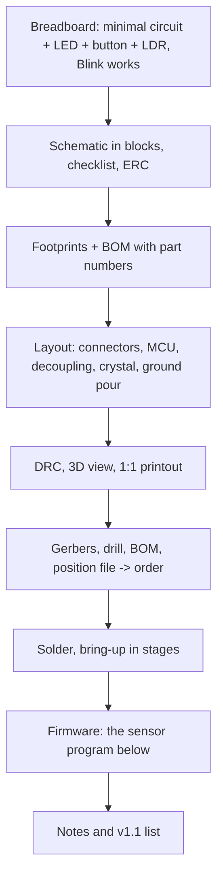

# Project: your own sensor board

Design, order, build and program your own ATmega328P board from scratch, following everything in this course. Here's the specification and a plan.

## Specification

| Feature | Requirement |
|---|---|
| MCU | ATmega328P, 16 MHz crystal, Arduino Uno compatible |
| Power | USB-C, polyfuse, power LED |
| Programming | CH340C USB-serial with auto-reset **and** a 6-pin ISP header |
| Inputs | 1 push button (D2), LDR divider on A0 |
| Outputs | 1 status LED (D13), 1 PWM LED (D9) |
| Expansion | I²C header (4 pins) with pull-ups; spare pins on a 2.54 mm header |
| Size | at most 50 × 40 mm, 2 layers, 2 × M3 mounting holes |
| Silkscreen | pin labels, board name, version, date, your name |

## The plan



## The firmware

When the board passes bring-up, load a real program: read the light level, show it as LED brightness, report over serial, and switch modes with the button.

```cpp
const int BUTTON = 2, STATUS_LED = 13, PWM_LED = 9, LDR = A0;
bool nightMode = false;
bool lastButton = HIGH;
unsigned long lastChange = 0;

void setup() {
  pinMode(BUTTON, INPUT_PULLUP);
  pinMode(STATUS_LED, OUTPUT);
  pinMode(PWM_LED, OUTPUT);
  Serial.begin(9600);
  Serial.println("sensor board v1.0");
}

void loop() {
  // debounced button: toggle mode on each press
  bool now = digitalRead(BUTTON);
  if (now != lastButton && millis() - lastChange > 50) {
    lastChange = millis();
    if (now == LOW) nightMode = !nightMode;
    lastButton = now;
  }

  int light = analogRead(LDR);                       // 0 (dark) to 1023 (bright)
  int brightness = map(light, 0, 1023, 255, 0);      // darker room -> brighter LED
  if (!nightMode) brightness = 0;
  analogWrite(PWM_LED, brightness);
  digitalWrite(STATUS_LED, nightMode);

  static unsigned long lastPrint = 0;
  if (millis() - lastPrint > 1000) {
    lastPrint = millis();
    Serial.print("light=");
    Serial.print(light);
    Serial.print(" mode=");
    Serial.println(nightMode ? "night" : "off");
  }
}
```

Notice there's no `delay()`: the loop runs continuously and uses `millis()` to time things, so the button always responds immediately. That's the normal style for real microcontroller programs.

## Going further

Pick one or more:

1. Add an I²C temperature and humidity sensor module (for example an SHT31 or BME280 breakout) on the I²C header, and print the readings.
2. Save the user's chosen mode in **EEPROM** so it survives power-off.
3. Put the board to **sleep** between readings and measure how much the current drops.
4. Design v1.1: move to SMD parts (TQFP-32 ATmega, 0603 passives) and have the factory assemble it.
5. Redesign the board around an **RP2040** or **ESP32**: the same blocks (power, decoupling, clock, programming, I/O) with a different chip.

## Share it

Publish the KiCad project, Gerbers, BOM, firmware and photos in a GitHub repository with a README describing the pins and how to program it. A working, documented board you designed yourself is one of the strongest things you can show in a hardware or embedded job interview.

## Summary

- Spec first, then breadboard, schematic, layout, checks, order, bring-up and firmware.
- Use `millis()` timing instead of `delay()` so inputs stay responsive.
- Extend with I²C sensors, EEPROM and sleep; share the full project openly.

## Optional videos

The lesson above is complete on its own. These videos go deeper, if you like learning by watching.

**Standalone ATmega328P custom PCB: bootloader and upload (Tech at Home)**

https://www.youtube.com/watch?v=kmmQRWfTBkg
