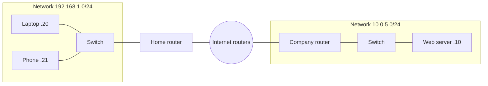

# Start here: hosts, addresses, networks and devices

A network moves data from one **host** to another. Everything in this course explains one sentence: *how does a packet from my laptop reach a server on the other side of the world, and back?*

## The key players

| Thing | What it is | Works with |
|---|---|---|
| **Host** | Anything that sends or receives data: laptop, phone, server, printer | IP addresses |
| **IP address** | A host's address on a network, like `192.168.1.20` | Layer 3 |
| **Network** | A group of hosts that can reach each other directly | |
| **Switch** | Connects hosts **inside** one network, forwards by MAC address | Layer 2 |
| **Router** | Connects **different** networks, forwards by IP address | Layer 3 |
| **Repeater / hub** | Old devices that copy signals to every port | Layer 1 |



- Inside a network, the **switch** delivers frames between hosts.
- Between networks, **routers** pass packets hop by hop.
- Your home "router" is really a router, a switch, a Wi-Fi access point, a firewall and a DHCP server in one box.

## Look at your own

```bash
ip -br addr          # your interfaces and IP addresses
ip route             # 'default via ...' is your router (the gateway)
```

## How this course works

Lessons stand on their own. The optional videos are from **Ed Harmoush (Practical Networking)**, one of the clearest networking teachers on YouTube. Each day has a hands-on task you can do on any Linux machine.

## Optional videos

The lesson above is complete on its own. These go deeper, if you like learning by watching.

**Practical Networking, Lesson 1a: hosts, IP addresses and networks**

https://www.youtube.com/watch?v=bj-Yfakjllc

**Practical Networking, Lesson 1b: repeaters, hubs, bridges, switches and routers**

https://www.youtube.com/watch?v=H7-NR3Q3BeI
