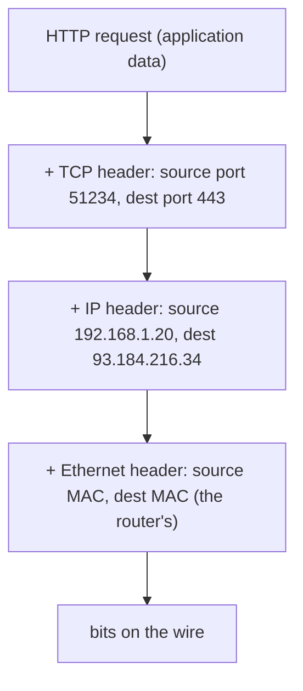

# Layers: OSI, TCP/IP and encapsulation

Networking is split into **layers**. Each layer does one job and relies on the one below.

| # | OSI layer | Job | Examples | Unit |
|---|---|---|---|---|
| 7 | Application | What the program wants | HTTP, DNS, SSH | Data |
| 6 | Presentation | Formats, encryption | TLS (roughly) | |
| 5 | Session | Conversations | (mostly folded into apps) | |
| 4 | **Transport** | Process to process: ports, reliability | TCP, UDP | Segment / datagram |
| 3 | **Network** | Host to host across networks: IP addresses, routing | IPv4, IPv6, ICMP | Packet |
| 2 | **Data link** | Hop to hop on one network: MAC addresses | Ethernet, Wi-Fi | Frame |
| 1 | Physical | Bits as signals | Copper, fibre, radio | Bits |

The internet actually uses the simpler **TCP/IP model** (application, transport, internet, link), but everyone still says "layer 2", "layer 3", "layer 7".

## Encapsulation

Each layer wraps the data from above in its own header:

On the way up at the receiver, each layer removes its header and hands the rest up (**de-encapsulation**).

## Why layers matter for troubleshooting

You check from the bottom up:

| Layer | Question | Command |
|---|---|---|
| 1-2 | Is the link up? | `ip link`, cable, Wi-Fi |
| 3 | Do I have an IP and a route? Can I reach the gateway? | `ip addr`, `ip route`, `ping` |
| 4 | Is the port open and listening? | `ss -tln`, `nc -zv host 443` |
| 7 | Does the application answer correctly? | `curl -v`, logs |

"It's DNS" and "it's the firewall" are layer 7 and layer 3/4 guesses. Walking up the layers turns guesses into checks.

## Optional videos

The lesson above is complete on its own. These go deeper, if you like learning by watching.

**Practical Networking, Lesson 2a: the OSI model, layers 1 to 3**

https://www.youtube.com/watch?v=LkolbURrtTs

**Practical Networking, Lesson 2b: layers 4 to 7 and encapsulation**

https://www.youtube.com/watch?v=0aGqGKrRE0g
