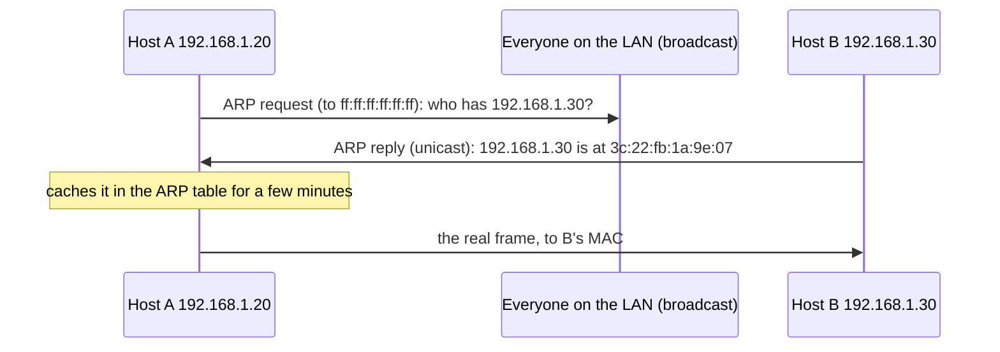

# ARP and switches

## ARP: from IP to MAC

A host knows the IP it wants to reach, but Ethernet needs a MAC. **ARP** asks the whole local network:



```bash
ip neigh           # the ARP (neighbour) cache
```

For a host on **another** network, A ARPs for the **gateway's** IP, not the far host's. A broken or missing gateway entry is a classic "local works, internet doesn't" problem.

IPv6 does the same job with **Neighbor Discovery** instead of ARP.

## How a switch works

A switch learns which MAC lives on which port by reading the **source** MAC of every frame:

| Frame's destination | Switch does |
|---|---|
| Known MAC (in its table) | Sends it out that one port only |
| Unknown MAC | **Floods** it out every port except the one it came in on |
| Broadcast (`ff:ff:...`) | Floods it everywhere |

That's why switches are efficient (most traffic goes only where needed), and why one network with thousands of hosts gets noisy: every ARP broadcast reaches everyone.

## VLANs

A **VLAN** splits one physical switch into several separate layer-2 networks (office, guests, servers). Hosts in different VLANs can only talk through a router or firewall, which is how networks are segmented for security. Cloud VPCs and subnets give you the same idea in software.

## Optional videos

The lesson above is complete on its own. These go deeper, if you like learning by watching.

**Practical Networking, Lesson 4a: switch functions**

https://www.youtube.com/watch?v=AhOU2eOpmX0

**Practical Networking, Lesson 4b: switch functions, part 2**

https://www.youtube.com/watch?v=G7GyWjJtjNs
