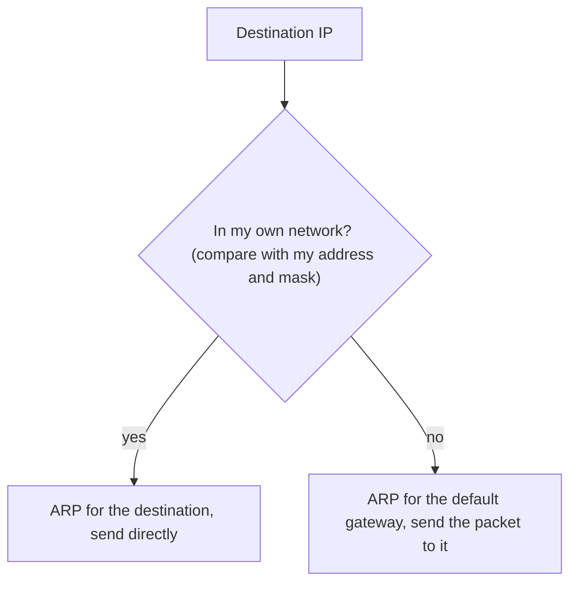

# Routing: gateways and routing tables

## A host's only routing decision



```bash
ip route
# default via 192.168.1.1 dev wlan0          <- everything else goes to the router
# 192.168.1.0/24 dev wlan0 proto kernel ...   <- my own network: deliver directly
ip route get 8.8.8.8                          # which route would be used for this IP
```

## How a router forwards

A router has a **routing table**: destination networks and where to send packets for them.

| Destination | Next hop | Interface |
|---|---|---|
| 10.0.5.0/24 | (directly connected) | eth1 |
| 10.0.8.0/22 | 10.0.0.2 | eth0 |
| 0.0.0.0/0 | 203.0.113.1 | eth2 (the internet) |

For each packet it picks the **longest prefix match**: the most specific route that contains the destination. `10.0.9.7` matches both `10.0.8.0/22` and `0.0.0.0/0`; /22 is more specific, so it wins.

At every hop:

- the router **decrements the TTL** (time to live) and drops the packet at 0 (this stops loops, and it's how `traceroute` works),
- it rebuilds the **Ethernet** header for the next link,
- the **IP addresses stay the same** (unless NAT is involved, Day 5).

## Where routes come from

| Source | Example |
|---|---|
| Directly connected networks | Added automatically for each interface address |
| Static routes | `sudo ip route add 10.8.0.0/16 via 10.0.0.2` |
| Routing protocols | OSPF inside a company, **BGP** between internet providers |
| Cloud route tables | "0.0.0.0/0 -> internet gateway" in a VPC |

## Optional videos

The lesson above is complete on its own. These go deeper, if you like learning by watching.

**Practical Networking, Lesson 3b: host to host through a router**

https://www.youtube.com/watch?v=JI9Zm2tbUoE

**Practical Networking, Lesson 5a: router functions**

https://www.youtube.com/watch?v=AzXys5kxpAM

**Practical Networking, Lesson 5b: router functions, part 2**

https://www.youtube.com/watch?v=Ep-x_6kggKA
