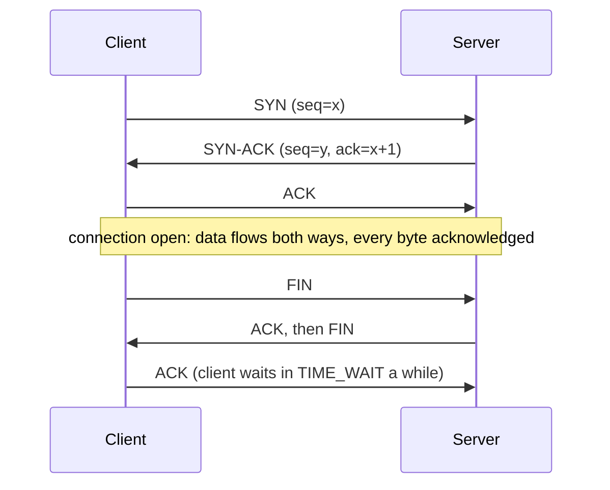

# TCP, UDP, ports and sockets

IP gets a packet to the right **host**. The transport layer gets it to the right **program**, using **ports**.

## A connection is four numbers

`192.168.1.20:51234 -> 93.184.216.34:443`: source IP and port, destination IP and port. The server listens on a well-known port; your side gets a random high port (**ephemeral**).

| Port | Service |
|---|---|
| 22 | SSH |
| 53 | DNS (UDP and TCP) |
| 80 / 443 | HTTP / HTTPS |
| 25, 587 | Mail |
| 3306 / 5432 / 6379 | MySQL / PostgreSQL / Redis |

## TCP: a reliable stream



TCP gives you:

- **Ordering and no gaps**: sequence numbers; missing data is retransmitted.
- **Flow control**: the receiver says how much it can take (the window).
- **Congestion control**: senders slow down when packets get lost, so the internet doesn't collapse. That's why one lost packet hurts throughput so much on long links.

## UDP: just send it

No handshake, no retransmits, no ordering. Fast and simple. Used where late data is useless (voice, video, games) or where the app does its own reliability: DNS, and **QUIC**, which carries HTTP/3 over UDP.

## Sockets on Linux

```bash
ss -tlnp                 # TCP listening sockets and their programs
ss -tn state established # open connections
ss -s                    # counts per state
nc -zv example.com 443   # can I open a TCP connection to this port?
```

Connection states worth knowing: `LISTEN` (waiting for clients), `ESTAB` (open), `TIME_WAIT` (recently closed, normal in big numbers on busy clients), `SYN-SENT` stuck (the other side or a firewall isn't answering), `CLOSE-WAIT` piling up (your app isn't closing connections: a bug).

## Refused vs timeout

| Result | Means |
|---|---|
| **Connection refused** | The host answered: nothing is listening on that port (or a firewall actively rejected) |
| **Timed out** | No answer at all: host down, wrong route, or a firewall silently dropping |

That one distinction cuts most debugging in half.

## Optional videos

The lesson above is complete on its own. These go deeper, if you like learning by watching.

**MIT 6.858, Lecture 13: Network protocols**

https://www.youtube.com/watch?v=QOtA76ga_fY
