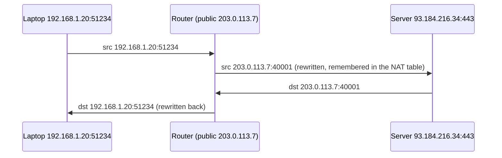

# NAT and IPv6

## NAT: many private hosts, one public address

Private addresses (`10.x`, `192.168.x`) can't be routed on the internet. Your router rewrites them on the way out:



Consequences:

- Outbound connections just work; **inbound** ones don't, unless you add a **port forward** (destination NAT).
- A cloud **NAT gateway** lets private servers reach the internet for updates without being reachable from it.
- Docker uses NAT to give containers internet access, and port publishing (`-p 8080:80`) is destination NAT.
- On Linux, NAT is an nftables/iptables rule (`masquerade`), covered in the next course.

## IPv6

IPv4's 4.3 billion addresses ran out. IPv6 has 128-bit addresses: `2001:db8:85a3::8a2e:370:7334`.

| | IPv4 | IPv6 |
|---|---|---|
| Size | 32 bits | 128 bits |
| Written as | Decimal bytes | Hex groups; `::` replaces one run of zeros |
| Typical subnet | /24 | /64 (always, for normal LANs) |
| Address setup | DHCP | Usually SLAAC (hosts build their own from the router's announcement), or DHCPv6 |
| Find neighbours | ARP | Neighbor Discovery (ICMPv6) |
| NAT | Everywhere | Normally not needed: every device can have a global address |
| Loopback | 127.0.0.1 | ::1 |

Important for servers: without NAT, devices with IPv6 are **directly reachable** unless a firewall stops it. Firewalls must cover IPv6 too (nftables `inet` tables do both).

```bash
ip -6 addr
ping -6 -c 3 google.com
curl -6 https://ifconfig.co      # your public IPv6, if you have one
```

`fe80::` addresses are **link-local**: present on every interface, valid only on that link.
