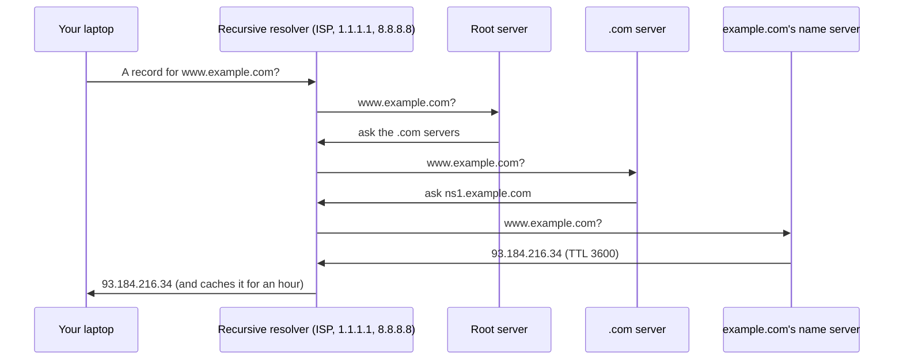

# DNS and DHCP

## DNS: names to addresses



| Record | Holds | Example |
|---|---|---|
| A / AAAA | IPv4 / IPv6 address | `www -> 93.184.216.34` |
| CNAME | An alias to another name | `shop -> shops.myshopify.com` |
| MX | Mail servers | `10 mail.example.com` |
| TXT | Text: SPF, domain verification | `"v=spf1 include:_spf.google.com ~all"` |
| NS | The domain's name servers | |
| PTR | Reverse: IP to name | |

```bash
dig www.example.com              # full answer, with TTL
dig +short example.com MX
dig @1.1.1.1 example.com         # ask a specific resolver
dig +trace example.com           # follow the chain from the root yourself
```

**TTL** is why DNS changes "take time": resolvers keep the old answer until it expires. Lower the TTL a day before a planned move.

## DHCP: addresses handed out automatically

When a device joins a network: **D**iscover (broadcast "anyone?"), **O**ffer, **R**equest, **A**cknowledge: **DORA**. The server gives an IP, mask, gateway, DNS servers and a **lease** time.

- Servers usually get **static** addresses or DHCP **reservations** (always the same IP for a MAC).
- A host with `169.254.x.x` didn't get an answer from DHCP.
- Cloud VMs use DHCP too; the cloud fills in the answers.

## Optional videos

The lesson above is complete on its own. These go deeper, if you like learning by watching.

**Practical Networking, Lesson 6: network protocols (DNS, DHCP, HTTP, TLS and more)**

https://www.youtube.com/watch?v=E5bSumTAHZE
