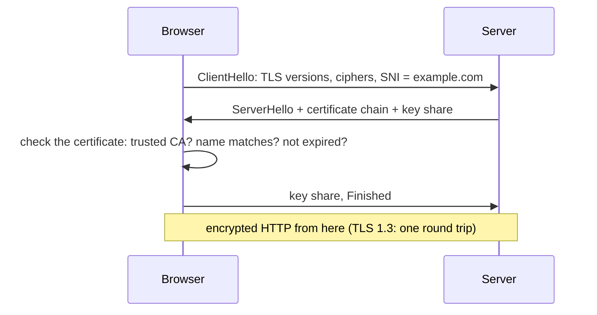

# HTTP and TLS, from the network's point of view

## HTTP in one exchange

```bash
curl -v http://example.com/
```

```text
> GET / HTTP/1.1
> Host: example.com
> User-Agent: curl/8.5.0
>
< HTTP/1.1 200 OK
< Content-Type: text/html
< Content-Length: 1256
```

- The **Host** header lets one IP serve many websites.
- Status codes: `2xx` OK, `3xx` redirect, `4xx` your request is wrong (404 not found, 403 forbidden), `5xx` the server failed (502 bad gateway, 503 unavailable, 504 timeout from a proxy).
- HTTP/1.1 and HTTP/2 run over TCP; HTTP/3 over QUIC (UDP).

## TLS: what the S in HTTPS does



TLS gives **encryption** (nobody on the path can read it), **integrity** (nobody can change it) and **authentication** (the certificate proves it's really example.com).

- **SNI** sends the hostname in the clear so the server knows which certificate to present.
- A certificate is signed by a **certificate authority** your system trusts (Let's Encrypt, DigiCert...).

```bash
openssl s_client -connect example.com:443 -servername example.com </dev/null | head -20
echo | openssl s_client -connect example.com:443 2>/dev/null | openssl x509 -noout -dates -subject -issuer
curl -vI https://example.com 2>&1 | grep -E 'SSL|subject|expire'
```

Certificate errors you'll meet: **expired**, **name mismatch** (you used the IP, or the wrong hostname), and **incomplete chain** (the server didn't send the intermediate certificate). The Linux Networking & Security course sets up TLS properly.

## Optional videos

The lesson above is complete on its own. These go deeper, if you like learning by watching.

**MIT 6.858, Lecture 14: SSL and HTTPS**

https://www.youtube.com/watch?v=q1OF_0ICt9A
