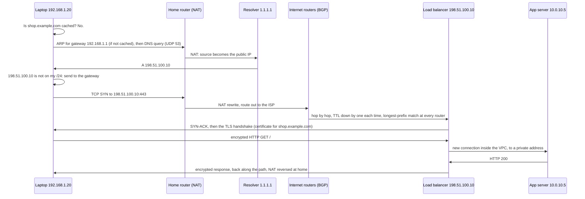

# A packet's whole journey

Put it all together: you type `https://shop.example.com` on a laptop at home.



## Day by day

| Step | Day |
|---|---|
| Same network or not, gateway, ARP | 2, 4 |
| DNS lookup | 6 |
| Private address and NAT | 3, 5 |
| Routing hop by hop, BGP between providers | 4 |
| TCP handshake, ports | 5 |
| TLS and certificates | 6 |
| Latency of all those round trips | 7 |

## The same journey as commands

```bash
ip route get 198.51.100.10        # which gateway and interface
ip neigh                          # the gateway's MAC
dig +short shop.example.com       # DNS
traceroute -n -T -p 443 shop.example.com   # the path, using TCP 443
curl -v https://shop.example.com  # TCP, TLS and HTTP in one go
```

## Optional videos

The lesson above is complete on its own. These go deeper, if you like learning by watching.

**Practical Networking, Lesson 7: packet traveling, host to switch to router to router to host**

https://www.youtube.com/watch?v=YJGGYKAV4pA
