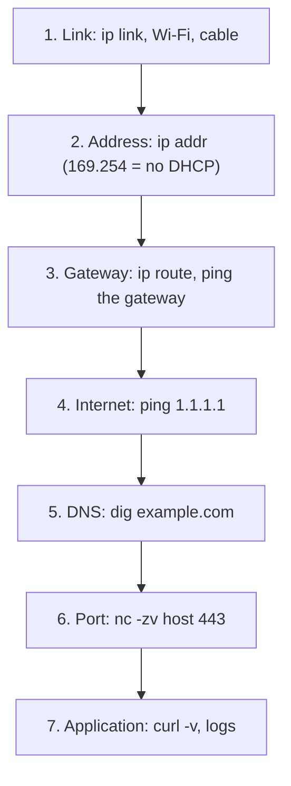

# Capstone: troubleshooting by layer

Six common complaints. For each, the order to check, and the command that tells you.

| Complaint | Most likely | Prove it with |
|---|---|---|
| "No internet" but Wi-Fi shows connected | No IP (DHCP) or no gateway | `ip addr`, `ip route`, `ping` the gateway |
| "Google by IP works, by name doesn't" | DNS | `dig google.com`, `resolvectl status` |
| "The site works for me, not for a colleague" | DNS cache/TTL, or their network | `dig @1.1.1.1` vs their resolver |
| "Can't connect to the database" | Refused (not listening) vs timeout (firewall/route) | `nc -zv db 5432`, then `ss -tlnp` on the server |
| "SSH connects but freezes on big output" | MTU | `ping -M do -s 1472` |
| "Slow sometimes" | Loss or congestion on the path | `mtr -rwc 100`, `iperf3` |

## Write it down like an engineer

For each problem: **symptom**, **what you checked** (in order, with output), **the layer where it broke**, **the fix**, **how you verified**. That record is also the first draft of a runbook.

## What's next

**Linux Networking & Security** takes this to the server side: configuring interfaces and routes, nftables firewalls, NAT, TLS certificates, SSH hardening and finding intruders.
