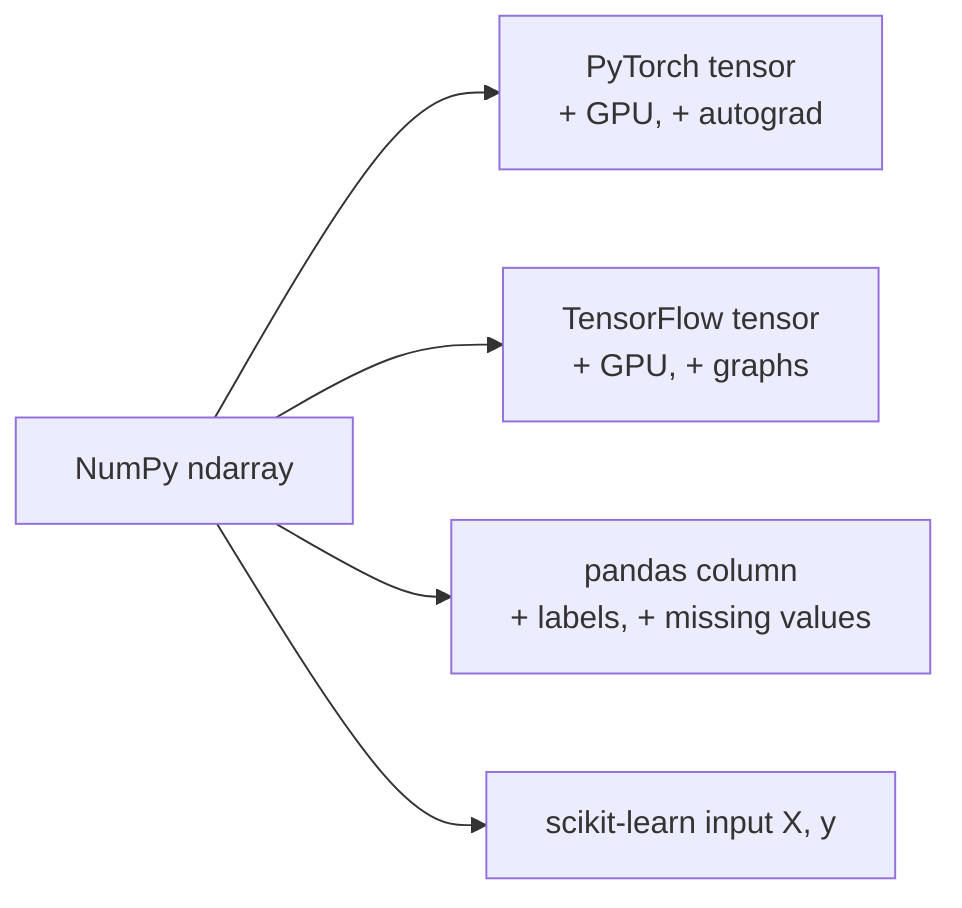

# Arrays: the data structure under every ML library

PyTorch tensors, TensorFlow tensors, pandas columns and scikit-learn inputs all share one idea: an **n-dimensional array** of numbers of one type, stored in one block of memory. NumPy is where that idea started, and its rules (shapes, dtypes, broadcasting, indexing) carry over almost unchanged to every deep learning library. Learn them once here.



## Why not Python lists?

A list holds pointers to separate Python objects; an array holds raw numbers side by side. Operations on arrays run in compiled code over the whole block at once (**vectorization**).

```python
import time
import numpy as np

n = 1_000_000
py = list(range(n))
arr = np.arange(n)

t = time.perf_counter(); s1 = sum(x * x for x in py); t_list = time.perf_counter() - t
t = time.perf_counter(); s2 = int((arr * arr).sum()); t_np = time.perf_counter() - t
print(s1 == s2, f"list {t_list * 1000:.0f} ms, NumPy {t_np * 1000:.1f} ms")
```

NumPy is usually several times faster even on this simple sum, and the gap grows to tens or hundreds of times with real maths on bigger arrays.

## Creating arrays

```python
a = np.array([[1, 2, 3], [4, 5, 6]])        # from nested lists
print(a.shape, a.ndim, a.dtype, a.size)       # (2, 3) 2 int64 6

print(np.zeros((2, 3)))                       # all zeros, float64 by default
print(np.ones(3, dtype=np.float32))           # choose the type
print(np.arange(0, 10, 2))                    # [0 2 4 6 8], like range
print(np.linspace(0, 1, 5))                   # 5 evenly spaced points from 0 to 1
print(np.eye(3))                              # identity matrix

rng = np.random.default_rng(seed=42)          # the modern random API: always pass a seed for repeatable results
print(rng.normal(size=(2, 2)).round(3))       # standard normal
print(rng.integers(0, 10, size=5))            # integers from 0 to 9
```

## Shape and dtype are everything

- **shape** is a tuple: `(rows, columns)` for a matrix, `(batch, height, width, channels)` for a batch of images. Most bugs in ML code are shape bugs, so print shapes often.
- **dtype** is the number type. Deep learning mostly uses `float32` (half the memory of NumPy's default `float64`, and what GPUs are fast at). Labels are often `int64`.

```python
x = np.array([1.5, 2.5])
print(x.dtype, x.astype(np.float32).dtype, x.astype(np.int64))   # float64 float32 [1 2]: astype truncates
print(np.array([1, 2]) / 2)                                       # [0.5 1. ]: division makes floats
```

Next lesson: reshaping and indexing, the two skills you'll use on every tensor for the rest of the series.

## Optional videos

The lesson above is complete on its own. These go deeper, if you like learning by watching.

**Complete Python NumPy Tutorial (Keith Galli)**

https://www.youtube.com/watch?v=GB9ByFAIAH4
