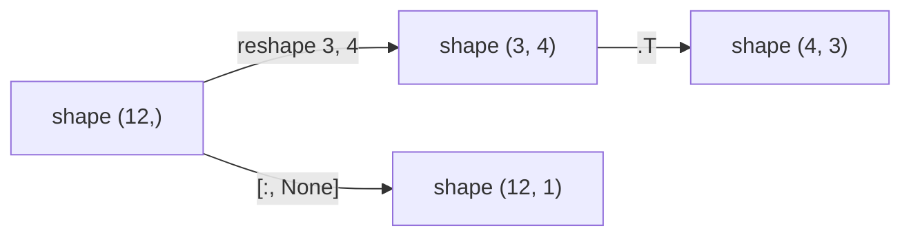

# Reshape, index and slice

## Reshape

`reshape` changes how the same numbers are grouped, without copying when it can. The total size must stay the same; use `-1` to let NumPy work out one dimension.

```python
import numpy as np

x = np.arange(12)
print(x.reshape(3, 4))
print(x.reshape(2, -1).shape)        # (2, 6)
images = np.zeros((32, 28, 28))       # 32 grayscale images of 28×28
flat = images.reshape(32, -1)         # flatten each image for a simple model
print(flat.shape)                     # (32, 784)

print(x.reshape(3, 4).T.shape)        # transpose: (4, 3)
col = np.array([1, 2, 3])[:, None]    # add an axis: (3,) -> (3, 1)
print(col.shape, np.expand_dims(np.array([1, 2, 3]), 0).shape)   # (3, 1) (1, 3)
print(np.zeros((1, 3, 1)).squeeze().shape)                       # remove size-1 axes: (3,)
```



## Indexing and slicing

Each axis gets its own index, separated by commas. Slices `start:stop:step` exclude `stop`.

```python
m = np.arange(1, 13).reshape(3, 4)
print(m[0, 1])          # row 0, column 1 -> 2
print(m[1])             # whole row 1
print(m[:, 2])          # whole column 2
print(m[:2, 1:3])       # rows 0-1, columns 1-2
print(m[::-1])          # rows reversed
print(m[..., -1])       # last column; ... means "all the axes before"
```

**Slices are views:** they share memory with the original. Changing a slice changes the original. Use `.copy()` when you need independence.

```python
v = m[0]
v[0] = 100
print(m[0, 0])                  # 100: the original changed
safe = m[0].copy(); safe[0] = -1
print(m[0, 0])                  # still 100
```

## Boolean masks and fancy indexing

```python
scores = np.array([55, 91, 72, 38, 88])
passed = scores >= 60
print(passed)                   # [False  True  True False  True]
print(scores[passed])           # [91 72 88]
print(scores[[0, 2, 4]])        # pick positions: [55 72 88]
scores[scores < 60] = 60        # set with a mask
print(scores)
print(np.where(scores > 80, "high", "ok"))
```

Masks and fancy indexing **copy** (unlike slices). These exact patterns, `x[mask]`, `x[idx]`, `torch.where`, appear in PyTorch with the same syntax.
