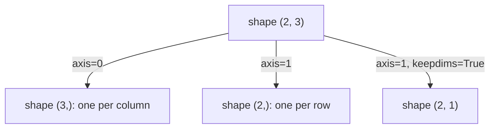

# Vectorized maths and axis

## Element-wise operations and ufuncs

Arithmetic between arrays of the same shape works element by element, and NumPy's **ufuncs** (`np.exp`, `np.log`, `np.sqrt`, `np.maximum`...) apply to every element.

```python
import numpy as np

a = np.array([1.0, 2.0, 3.0])
b = np.array([10.0, 20.0, 30.0])
print(a + b, a * b, b / a, a ** 2)
print(np.exp(a).round(2), np.log(b).round(2))
relu = np.maximum(0, np.array([-2.0, 0.5, 3.0]))
print(relu)                     # [0.  0.5 3. ]: the ReLU activation in one line
```

## Reductions and the axis argument

`sum`, `mean`, `max`, `argmax`, `std` reduce an array. **`axis` says which dimension disappears.**

```python
m = np.array([[1, 2, 3],
              [4, 5, 6]])
print(m.sum())                  # 21: everything
print(m.sum(axis=0))            # [5 7 9]: down the rows, one value per column
print(m.sum(axis=1))            # [ 6 15]: across the columns, one value per row
print(m.mean(axis=1, keepdims=True).shape)   # (2, 1): keep the axis for later broadcasting
print(m.argmax(axis=1))         # [2 2]: index of the max in each row
```



A trick to remember: `axis=0` collapses the first number in the shape, `axis=1` the second.

## Matrix multiplication

`*` is element-wise. Matrix multiplication is `@` (or `np.matmul`): `(n, k) @ (k, m)` gives `(n, m)`. It's the core of every neural network layer: inputs times weights.

```python
X = np.random.default_rng(0).normal(size=(4, 3))   # 4 examples, 3 features
W = np.ones((3, 2))                                 # weights for 2 outputs
bias = np.array([0.5, -0.5])
out = X @ W + bias                                  # a linear layer
print(out.shape)                                    # (4, 2)
print(np.dot(np.array([1, 2, 3]), np.array([4, 5, 6])))   # dot product: 32
```

## A complete example: softmax and accuracy

```python
logits = np.array([[2.0, 1.0, 0.1],
                   [0.5, 2.5, 0.3]])
z = logits - logits.max(axis=1, keepdims=True)      # subtract the row max: avoids overflow in exp
probs = np.exp(z) / np.exp(z).sum(axis=1, keepdims=True)
print(probs.round(3), probs.sum(axis=1))            # each row sums to 1
labels = np.array([0, 2])
pred = probs.argmax(axis=1)
print("accuracy:", (pred == labels).mean())         # 0.5
```

No loops: that's the style every later lesson uses.
