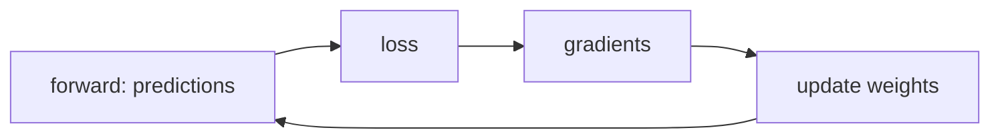

# Broadcasting, and a model from scratch

## Broadcasting

When shapes differ, NumPy **broadcasts**: it stretches size-1 axes (without copying memory) so the shapes match. The rule, comparing shapes from the **right**: two dimensions are compatible if they're equal or one of them is 1.

```python
import numpy as np

X = np.arange(6, dtype=float).reshape(3, 2)    # (3, 2)
print(X - X.mean(axis=0))                       # (3, 2) - (2,): centre each column
print(X / X.max(axis=1, keepdims=True))         # (3, 2) / (3, 1): scale each row
print(np.arange(3)[:, None] + np.arange(4))     # (3, 1) + (4,) -> (3, 4) table
```

| Shapes | Result |
|---|---|
| (3, 2) and (2,) | (3, 2) |
| (3, 2) and (3, 1) | (3, 2) |
| (3, 1) and (1, 4) | (3, 4) |
| (3, 2) and (3,) | error: 2 vs 3 on the right |

That last row is the classic bug: you meant one value per row but forgot `keepdims=True`.

## Pairwise distances without loops

Broadcasting turns double loops into one line. Distances from every point in A to every point in B:

```python
rng = np.random.default_rng(1)
A = rng.normal(size=(5, 2))
B = rng.normal(size=(3, 2))
D = np.sqrt(((A[:, None, :] - B[None, :, :]) ** 2).sum(axis=-1))   # (5, 1, 2) - (1, 3, 2) -> (5, 3, 2)
print(D.shape)                                                      # (5, 3)
print(D.argmin(axis=1))                                             # the nearest B for each A
```

This is the core of k-nearest neighbours and of k-means clustering.

## Linear regression with gradient descent, in NumPy

Everything so far, in one small model. This is exactly what PyTorch automates in the next courses.

```python
rng = np.random.default_rng(0)
X = rng.normal(size=(200, 3))
true_w, true_b = np.array([2.0, -1.0, 0.5]), 3.0
y = X @ true_w + true_b + rng.normal(scale=0.1, size=200)

w, b, lr = np.zeros(3), 0.0, 0.1
for step in range(200):
    pred = X @ w + b                       # forward pass
    err = pred - y
    loss = (err ** 2).mean()               # mean squared error
    grad_w = 2 * X.T @ err / len(y)        # gradients, worked out by hand
    grad_b = 2 * err.mean()
    w -= lr * grad_w                       # gradient descent step
    b -= lr * grad_b
print(w.round(2), round(b, 2), round(loss, 4))   # close to [2, -1, 0.5] and 3
```



Writing gradients by hand is fine for one layer, painful for ten and impossible for a transformer. **Autograd** (PyTorch part 1) computes them for you.
