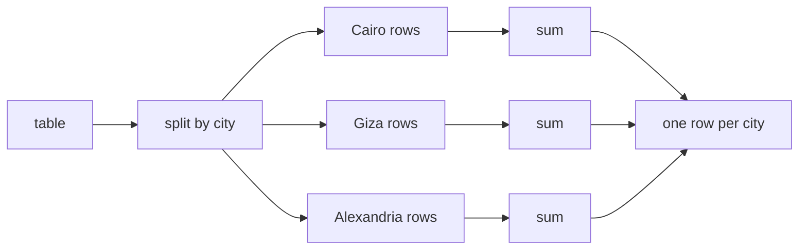

# groupby, merge and pivot

Most data questions are "per something": revenue per city, average rating per product, last purchase per customer. pandas answers them with **split, apply, combine**.



```python
import pandas as pd

orders = pd.DataFrame({
    "order_id": [1, 2, 3, 4, 5, 6],
    "customer_id": [10, 11, 10, 12, 10, 11],
    "city": ["Cairo", "Giza", "Cairo", "Alexandria", "Cairo", "Giza"],
    "category": ["books", "toys", "toys", "books", "games", "books"],
    "revenue": [240, 250, 600, 90, 400, 110],
})

print(orders.groupby("city")["revenue"].sum())
summary = orders.groupby("city").agg(
    orders=("order_id", "count"),
    revenue=("revenue", "sum"),
    avg_order=("revenue", "mean"),
).sort_values("revenue", ascending=False)
print(summary)
```

**Named aggregation** (`new_name=(column, function)`) gives clean column names, ready for a report or a model.

## transform: group statistics back on every row

```python
orders["customer_total"] = orders.groupby("customer_id")["revenue"].transform("sum")
orders["share_of_customer"] = (orders["revenue"] / orders["customer_total"]).round(2)
print(orders[["customer_id", "revenue", "customer_total", "share_of_customer"]])
```

`agg` returns one row per group; `transform` returns one value per original row. `transform` is how you build per-customer or per-product features for a model.

## merge: joining tables

```python
customers = pd.DataFrame({"customer_id": [10, 11, 13], "segment": ["gold", "new", "gold"]})
joined = orders.merge(customers, on="customer_id", how="left", validate="many_to_one")
print(joined[["order_id", "customer_id", "segment"]])
```

| how | keeps |
|---|---|
| `inner` | only keys found in both tables |
| `left` | every row of the left table (missing matches become NaN) |
| `outer` | every key from either table |

`validate="many_to_one"` raises an error if a customer appears twice in `customers`, which would silently duplicate orders. Always check row counts before and after a merge.

## pivot_table: a spreadsheet pivot in one line

```python
print(orders.pivot_table(index="city", columns="category", values="revenue", aggfunc="sum", fill_value=0))
```

## Optional videos

The lesson above is complete on its own. These go deeper, if you like learning by watching.

**Complete Python Pandas Data Science Tutorial (Keith Galli)**

https://www.youtube.com/watch?v=vmEHCJofslg
