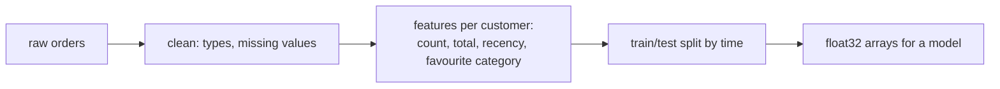

# Time series, speed and a full mini project

## Dates and resampling

```python
import numpy as np
import pandas as pd

rng = np.random.default_rng(0)
days = pd.date_range("2026-01-01", periods=90, freq="D")
sales = pd.Series(100 + 10 * np.sin(np.arange(90) / 7 * 2 * np.pi) + rng.normal(0, 5, 90), index=days)

print(sales.resample("W").sum().head(3))          # weekly totals
print(sales.rolling(7).mean().dropna().head(3))   # 7-day moving average
print(sales.shift(1).head(3))                     # yesterday's value: a lag feature
```

Lag and rolling features (`shift`, `rolling`) are the backbone of forecasting models. They must only use **past** data: a feature that peeks at tomorrow gives great test scores and a useless model.

## Speed: stay vectorized

```python
df = pd.DataFrame({"price": rng.uniform(10, 500, 100_000), "qty": rng.integers(1, 5, 100_000)})

slow = [row.price * row.qty for row in df.itertuples()]      # a Python loop: avoid for big data
fast = df["price"] * df["qty"]                               # vectorized
print(np.allclose(slow, fast))

df["band"] = np.select([df["price"] < 100, df["price"] < 300], ["low", "mid"], default="high")
print(df["band"].value_counts())
```

Rules: prefer column operations, `np.where` / `np.select` for conditions, `groupby` for per-group work; reach for `apply` with a Python function only when nothing else fits. For data bigger than memory, store it as **Parquet** (`df.to_parquet`) and look at tools such as Polars or DuckDB, which follow the same ideas.

## Mini project: from raw orders to a model-ready table



```python
n = 500
orders = pd.DataFrame({
    "customer_id": rng.integers(1, 51, n),
    "date": pd.Timestamp("2026-01-01") + pd.to_timedelta(rng.integers(0, 120, n), unit="D"),
    "category": rng.choice(["books", "toys", "games"], n),
    "revenue": rng.gamma(2.0, 100.0, n).round(2),
})
cutoff = pd.Timestamp("2026-04-01")
past, future = orders[orders["date"] < cutoff], orders[orders["date"] >= cutoff]

feats = past.groupby("customer_id").agg(
    n_orders=("revenue", "size"),
    total=("revenue", "sum"),
    last_date=("date", "max"),
)
feats["days_since_last"] = (cutoff - feats.pop("last_date")).dt.days
fav = past.groupby(["customer_id", "category"]).size().unstack(fill_value=0)
feats = feats.join(fav.add_prefix("n_"))

target = future.groupby("customer_id")["revenue"].sum().rename("next_month_revenue")
table = feats.join(target).fillna({"next_month_revenue": 0})
X = table.drop(columns="next_month_revenue").to_numpy(np.float32)
y = table["next_month_revenue"].to_numpy(np.float32)
print(table.head(3))
print(X.shape, y.shape)
```

Features come only from before the cutoff; the target only from after. That **time-based split** is how you avoid leakage in any prediction about the future.
