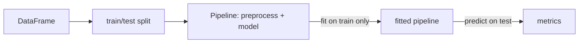

# scikit-learn: the bridge to deep learning

Before training a neural network, train a simple model with **scikit-learn**. It gives you a **baseline**: if a deep model can't beat a linear model or a random forest, the extra complexity isn't paying off. And its ideas (fit on train, transform test, pipelines, cross-validation) apply to every library in this series.



```python
import numpy as np
import pandas as pd
from sklearn.compose import ColumnTransformer
from sklearn.ensemble import RandomForestClassifier
from sklearn.linear_model import LogisticRegression
from sklearn.metrics import accuracy_score, classification_report
from sklearn.model_selection import train_test_split, cross_val_score
from sklearn.pipeline import Pipeline
from sklearn.preprocessing import OneHotEncoder, StandardScaler

rng = np.random.default_rng(0)
n = 1000
df = pd.DataFrame({
    "age": rng.integers(18, 70, n),
    "visits": rng.poisson(5, n),
    "city": rng.choice(["Cairo", "Giza", "Alexandria"], n),
})
logit = 0.04 * (df["age"] - 40) + 0.3 * (df["visits"] - 5) + (df["city"] == "Cairo") * 0.8
df["bought"] = (rng.random(n) < 1 / (1 + np.exp(-logit))).astype(int)

X, y = df.drop(columns="bought"), df["bought"]
X_train, X_test, y_train, y_test = train_test_split(X, y, test_size=0.2, random_state=0, stratify=y)

prep = ColumnTransformer([
    ("num", StandardScaler(), ["age", "visits"]),
    ("cat", OneHotEncoder(handle_unknown="ignore"), ["city"]),
])
for name, model in [("logistic", LogisticRegression()), ("forest", RandomForestClassifier(n_estimators=200, random_state=0))]:
    pipe = Pipeline([("prep", prep), ("model", model)])
    pipe.fit(X_train, y_train)
    acc = accuracy_score(y_test, pipe.predict(X_test))
    cv = cross_val_score(pipe, X_train, y_train, cv=5).mean()
    print(f"{name}: test accuracy {acc:.3f}, 5-fold CV {cv:.3f}")
print("always predicting the majority:", round(max(y_test.mean(), 1 - y_test.mean()), 3))
```

## Why the pipeline matters

The scaler learns means and standard deviations. If you fit it on all the data before splitting, the test set influences training: **leakage**. A `Pipeline` fits every step on training data only, and applies the same fitted steps to test data. Deep learning has the same rule: normalisation statistics come from the training set.

## Three baselines to beat

1. **The trivial one:** always predict the most common class (or the mean). Any model must beat this.
2. **A linear model:** fast, explainable, often surprisingly strong.
3. **Gradient-boosted trees or a random forest:** usually the best on tables of mixed features.

On **tabular data**, tree models often beat neural networks. Deep learning shines on images, text, audio and very large datasets, which is where PyTorch and TensorFlow come in, starting with the next course.
