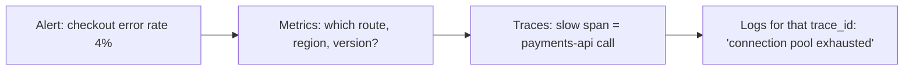

# The three signals: metrics, logs, traces

| Signal | Is | Great for | Cost |
|---|---|---|---|
| **Metrics** | Numbers over time, with labels: `http_requests_total{route="/checkout",status="500"}` | Dashboards, alerts, trends | Cheap, if labels stay bounded |
| **Logs** | Timestamped events, ideally structured (JSON) | The details of one error | Grows with traffic |
| **Traces** | One request's path across services, as timed **spans** | "Where did the 2 seconds go?" | Usually sampled |



The magic is **correlation**: logs and traces share a `trace_id`; metrics and logs share labels (`service`, `version`, `region`).

## Structured logs

```json
{"ts":"2026-11-17T14:03:11Z","level":"error","service":"shop-api","version":"sha-3f2c1ab",
 "route":"/checkout","status":500,"duration_ms":2140,"trace_id":"4bf92f3577b34da6","msg":"payment timeout"}
```

vs `ERROR payment timeout`. The first one can be filtered, counted and joined to a trace.

## Two checklists for what to measure

| Method | For | Measure |
|---|---|---|
| **RED** | Request-driven services | **R**ate, **E**rrors, **D**uration (latency distribution) |
| **USE** | Resources (CPU, disk, pools) | **U**tilisation, **S**aturation (queueing), **E**rrors |

Google's **four golden signals** combine them: latency, traffic, errors, saturation.

## Watch out: cardinality

Every unique combination of label values is a separate time series. `user_id` or `request_id` as a metric label can create millions and take down your metrics system. Put high-cardinality data in logs and traces.
