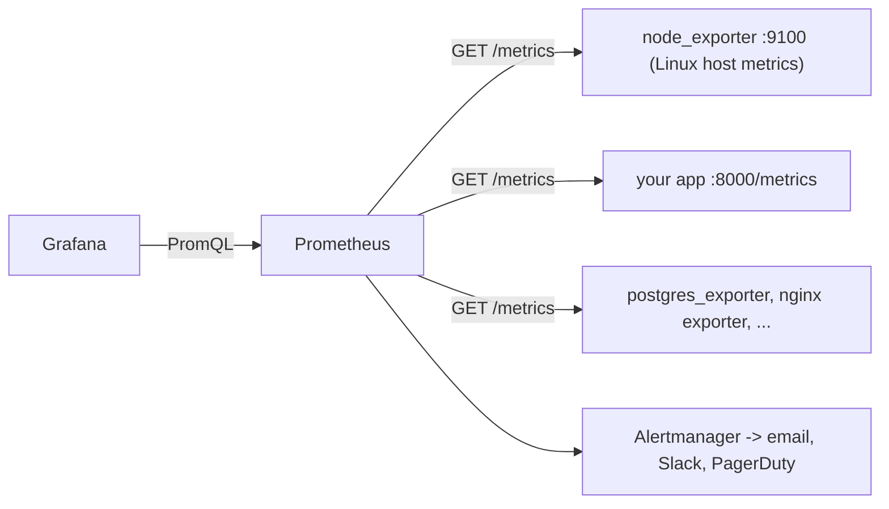

# Prometheus: collecting metrics

**Prometheus** *scrapes* (pulls) metrics over HTTP from targets every 15-30 seconds and stores them as time series.



## Run it

```yaml
# prometheus.yml
global: {scrape_interval: 15s}
scrape_configs:
  - job_name: node
    static_configs: [{targets: ["web01:9100", "web02:9100"]}]
  - job_name: shop-api
    static_configs: [{targets: ["web01:8000", "web02:8000"]}]
```

```bash
docker run -d --name prom -p 9090:9090 -v $PWD/prometheus.yml:/etc/prometheus/prometheus.yml prom/prometheus
# On each Linux host (from the Linux courses, as a systemd service):
./node_exporter    # exposes CPU, memory, disk, network, filesystem metrics on :9100
```

On AWS, `ec2_sd_configs` discovers targets by tag instead of a static list.

## Instrument your app

```python
from prometheus_client import Counter, Histogram, start_http_server
REQS = Counter("http_requests_total", "Requests", ["route", "status"])
LAT  = Histogram("http_request_duration_seconds", "Latency", ["route"],
                 buckets=[.05, .1, .25, .5, 1, 2.5, 5])

@app.route("/checkout")
def checkout():
    with LAT.labels("/checkout").time():
        ...
    REQS.labels("/checkout", "200").inc()
```

## Metric types

| Type | Goes | Example |
|---|---|---|
| Counter | Only up (resets on restart) | Requests, errors, bytes |
| Gauge | Up and down | Memory used, queue length, temperature |
| Histogram | Buckets of observations | Latency, response size |

Most frameworks and libraries have ready-made instrumentation; OpenTelemetry (Day 4) can produce these metrics too.
