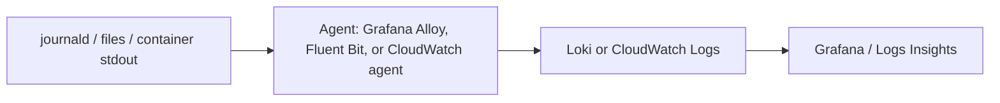

# Logs at scale: Loki and CloudWatch

`journalctl` and `less` work for one server. With twenty servers and containers that come and go, ship logs to one place.

| Tool | Model | Notes |
|---|---|---|
| **Grafana Loki** | Indexes only labels (service, host); stores log lines compressed; query with LogQL | Cheap; pairs with Prometheus/Grafana |
| Elasticsearch / OpenSearch | Full-text index of every field | Powerful search; heavier to run |
| **CloudWatch Logs** | Managed by AWS | Easiest on AWS; Logs Insights for queries |

## Shipping



## LogQL

```logql
{service="shop-api", env="prod"} |= "error"
{service="shop-api"} | json | status >= 500 | line_format "{{.route}} {{.msg}}"
sum by (route) (rate({service="shop-api"} | json | status >= 500 [5m]))   # metrics from logs
```

## Logging rules

- **Structured JSON**, one event per line, with `service`, `version`, `env`, `trace_id`.
- **Levels** that mean something: `error` = someone may need to act; `warn` = unusual but handled; `info` = business events; `debug` off in prod.
- **Never log secrets or personal data** (passwords, tokens, full card numbers, more personal data than needed). Scrub at the source.
- Set **retention** (e.g. 14-30 days hot, archive to S3 if required). Logs are often the biggest observability bill.
- Log **why**, not just **what**: `"payment timeout after 3 retries, provider=stripe"` beats `"error"`.
