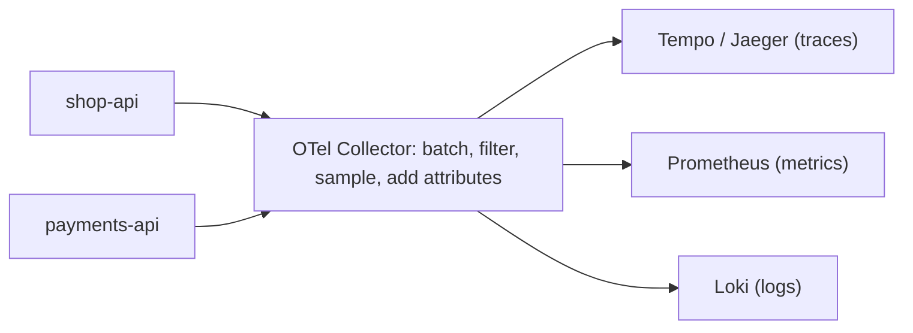

# Distributed tracing with OpenTelemetry

In a system of several services, one slow request can be slow anywhere. A **trace** shows its whole path:

```text
GET /checkout                      2140 ms
├─ auth.verify_token                 12 ms
├─ cart-service GET /cart            48 ms
│   └─ postgres SELECT cart_items    31 ms
├─ payments-api POST /charge       2010 ms   <-- here
│   └─ HTTP stripe.com               1990 ms
└─ postgres INSERT orders            19 ms
```

Each box is a **span** (name, start, duration, attributes, status); spans share a **trace ID**, passed between services in the `traceparent` HTTP header.

## OpenTelemetry (OTel)

The vendor-neutral standard for producing metrics, logs and traces. Instrument once, send anywhere (Jaeger, Grafana Tempo, AWS X-Ray, Honeycomb, Datadog...).

```bash
pip install opentelemetry-distro opentelemetry-exporter-otlp
opentelemetry-bootstrap -a install           # auto-instrument installed libraries (Flask, requests, psycopg...)
OTEL_SERVICE_NAME=shop-api \
OTEL_EXPORTER_OTLP_ENDPOINT=http://otel-collector:4317 \
OTEL_TRACES_SAMPLER=parentbased_traceidratio OTEL_TRACES_SAMPLER_ARG=0.1 \
opentelemetry-instrument gunicorn app:app
```

Add your own spans where the business logic is:

```python
from opentelemetry import trace
tracer = trace.get_tracer("shop")
with tracer.start_as_current_span("apply_discount") as span:
    span.set_attribute("coupon", code)
```

## The Collector



**Sampling**: keeping 100% of traces is expensive at scale. Sample a share, but keep **all errors and slow requests** (tail sampling in the Collector).
