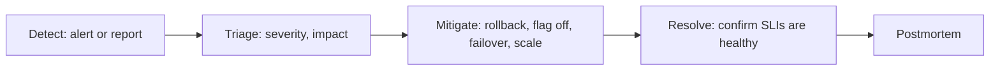

# Incident response

When users are hurt, **restore service first, find the root cause later.**

## Roles (even for a team of two)

| Role | Does |
|---|---|
| **Incident commander (IC)** | Coordinates, decides, keeps everyone on one plan. Doesn't debug |
| **Ops / responders** | Investigate and fix |
| **Communications** | Updates the status page and stakeholders every 30 minutes |
| **Scribe** | Timeline of what was seen and done, with times |

## The flow

## Mitigate first

Usual fastest fixes, before you understand the cause:

- **Roll back** the last deploy or config change (check deploy annotations).
- Turn off a **feature flag**.
- **Fail over** or drain a bad zone/instance.
- **Scale up** or shed load (rate limits, turn off non-essential features).

## Severity levels (example)

| Sev | Meaning | Response |
|---|---|---|
| 1 | Core function down for many users, data loss risk | All hands, page now, updates every 30 min |
| 2 | Major feature degraded or some users down | Page on-call |
| 3 | Minor, workaround exists | Business hours |

## On-call that people can sustain

Rotations of at least 6-8 people, handover notes, alert load reviewed weekly, time off after a bad night, and runbooks for every page. On-call pain is a reliability bug: track and fix it.
