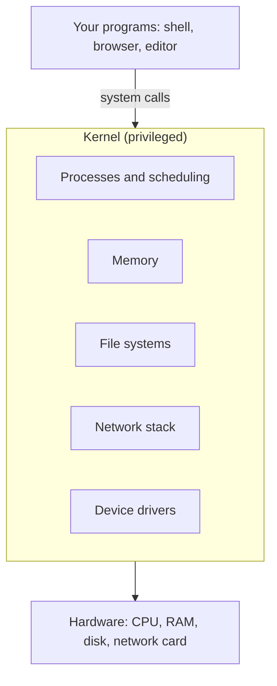

# Start here: what an operating system does

An operating system (OS) is the program that sits between your programs and the hardware. Every time a program reads a file, opens a network connection, or just runs on the CPU, the OS is involved.

## Three jobs

| Job | What it means | Example |
|---|---|---|
| **Virtualize** | Give every program the illusion it has the machine to itself | Each process thinks it owns the CPU and all of memory |
| **Share safely** | Many programs, one machine, no program can wreck another | Your browser can't read your password manager's memory |
| **Persist** | Keep data safe across crashes and reboots | Files, directories, journals |

These three ideas (virtualization, concurrency, persistence) are the backbone of this course, and the backbone of the free textbook *Operating Systems: Three Easy Pieces* (OSTEP) by Remzi and Andrea Arpaci-Dusseau.

## Kernel and user space

- **User space** is where normal programs run. They can't touch hardware directly.
- **The kernel** is the part of the OS that runs with full privilege. It owns the hardware and decides who gets what.
- The line between them is enforced **by the CPU itself**, not by politeness.

## How this course works

- Each day has short lessons, a practical task, an "explain it in your words" task and a quiz.
- Lessons stand on their own. Under each one are **optional videos** from MIT's operating systems course (6.S081, taught by Robert Morris and Frans Kaashoek) and from Remzi Arpaci-Dusseau's lectures at the University of Wisconsin, who wrote OSTEP.
- The OSTEP book is free (link at the top of the course). Reading the matching chapter is the best extra you can do.
- You need a Linux machine or a Linux terminal for the practical tasks: a VM, WSL on Windows, a cloud server, or a Raspberry Pi all work.

By the last day you'll be able to answer: **what really happens when I type `ls` and press Enter?**

## Optional videos

The lesson above is complete on its own. These lectures go deeper, if you like learning by watching.

**MIT 6.S081, Lecture 1: Introduction and examples**

https://www.youtube.com/watch?v=L6YqHxYHa7A

**Remzi Arpaci-Dusseau, Lecture 1 part 1: intro and OS basics**

https://www.youtube.com/watch?v=3uMbb9dLtlE
