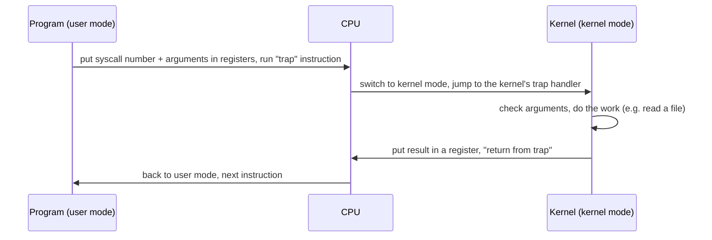
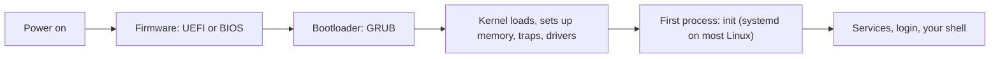

# System calls, privilege, interrupts and booting

## Two modes

The CPU runs in one of (at least) two modes:

- **User mode**: can do arithmetic and touch its own memory. Can't talk to devices, change page tables, or turn off interrupts.
- **Kernel mode** (supervisor mode): can do everything.

If a user program tries a privileged instruction, the CPU refuses and hands control to the kernel, which usually kills the program.

## System calls: the only door in

A program that wants something from the OS makes a **system call**:



Important details:

- The program can't choose **where** in the kernel it lands. The kernel sets up a **trap table** at boot, so the only entry points are the ones the kernel allows.
- The kernel **never trusts the arguments**. A pointer passed in might point at kernel memory; the kernel checks it.
- Libraries hide this. `printf` in C ends up calling the `write` system call; Python's `open()` ends up calling `openat`.

You can watch system calls happen on Linux:

```bash
strace -c ls          # count the system calls ls makes
strace ls 2>&1 | head # see the first few, one per line
```

## Interrupts and exceptions

The kernel also gets control when:

| Event | Caused by | Example |
|---|---|---|
| **Interrupt** | Hardware, at any time | Timer tick, a key press, a network packet arrives, a disk read finished |
| **Exception** (fault) | The current instruction | Divide by zero, touching an address that isn't mapped (page fault) |
| **System call** | The program asks on purpose | `read`, `write`, `fork` |

The **timer interrupt** matters most: it fires many times a second, so the kernel always gets the CPU back, even from a program stuck in an infinite loop. That's how one program can't hog the machine.

## Booting, in one picture



We'll come back to each box on the last day, and the Linux System Administration course goes deeper.

## Optional videos

The lesson above is complete on its own. These lectures go deeper, if you like learning by watching.

**MIT 6.S081, Lecture 3: OS organization and system calls**

https://www.youtube.com/watch?v=o44d---Dk4o

**Remzi Arpaci-Dusseau, Lecture 1 part 2**

https://www.youtube.com/watch?v=K4qbAiC77Yo
