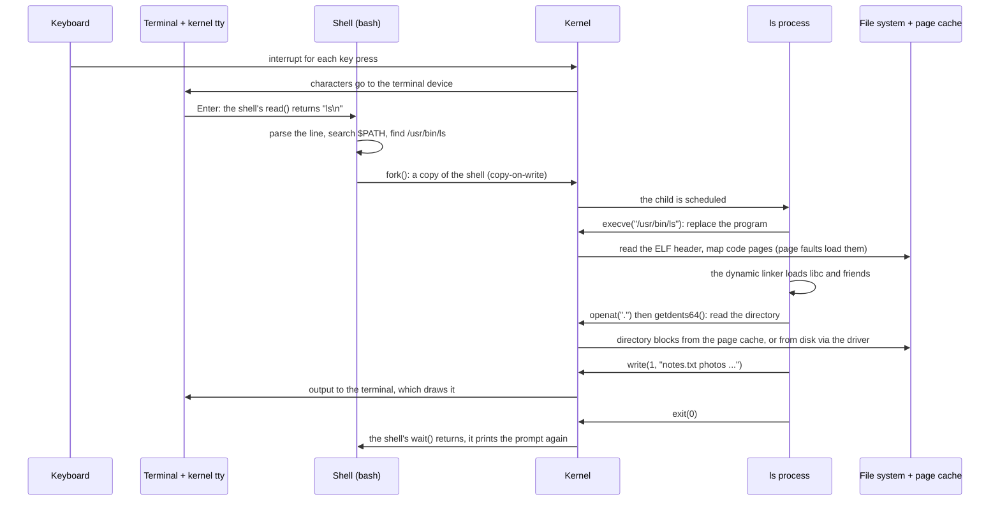

# Putting it together: what happens when you type ls

Every part of this course shows up in one ordinary command.



## Map it to the days

| Step | Day |
|---|---|
| Key press interrupts, terminal driver | 1, 7 |
| Shell blocked in `read()`, woken up | 2 |
| `fork`, `execve`, `wait`, zombie until reaped | 2 |
| The scheduler runs the new process | 3 |
| Page faults load the program's pages on demand | 6 |
| `openat`, `getdents64`, inodes, page cache | 8 |
| `write` to file descriptor 1 | 8 |

## Check it yourself

```bash
strace -f -o /tmp/trace.txt bash -c 'ls > /dev/null'
grep -E 'execve|openat|getdents|write|exit' /tmp/trace.txt | head -30
/usr/bin/time -v ls 2>&1 | grep -E 'faults|switches'
ldd /usr/bin/ls      # the shared libraries the dynamic linker loads
```

You'll see `execve`, the `openat` calls loading libraries, `getdents64` reading the directory, and the final `write`. Every line of that trace is something you can now explain.

## Where to go next

- **Linux Fundamentals & Command Line**: use all of this every day.
- **Advanced Linux & System Internals**: `/proc`, signals, namespaces and cgroups: the same ideas, on Linux specifically.
- The free OSTEP book, cover to cover, is the best single next step for depth.

## Optional videos

The lesson above is complete on its own. These lectures go deeper, if you like learning by watching.

**MIT 6.S081, Lecture 17: Virtual memory for applications**

https://www.youtube.com/watch?v=YNQghIvk0jc

**Remzi Arpaci-Dusseau, Lecture 14 part 4: words of wisdom**

https://www.youtube.com/watch?v=sKTyhqvTUBU
