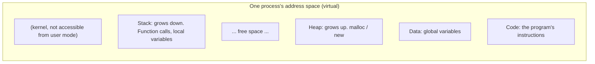
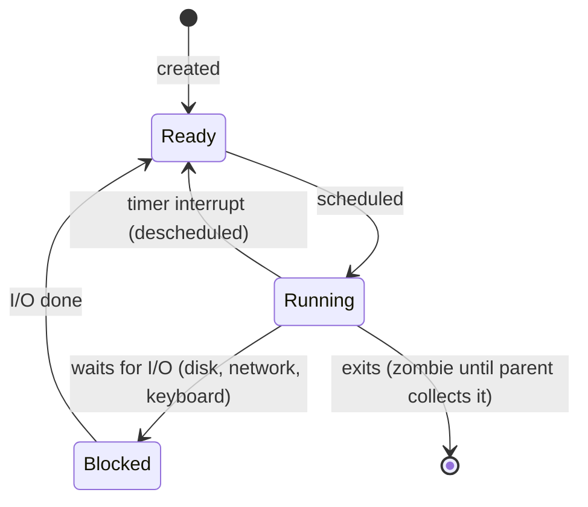

# Processes: a program in motion

A **program** is a file on disk: code and data, doing nothing. A **process** is that program running: it has memory, open files, a position in its code, and a state.

## What the OS keeps for every process

| Part | What it is |
|---|---|
| **PID** | A number that names the process |
| **Address space** | Its private view of memory: code, heap, stack |
| **Registers** | Including the program counter (where it is in the code) and the stack pointer |
| **Open files** | A table of file descriptors (0 = input, 1 = output, 2 = errors) |
| **State** | Running, ready, blocked, or finished |
| **Parent** | The process that created it |

The kernel keeps all this in a structure often called the **process control block** (in Linux, `struct task_struct`).

## The address space



Every process sees addresses starting from the same numbers, but they point at **different** physical memory. Day 6 explains how.

## Process states



## Creating processes on Unix: fork, exec, wait

Unix splits "create a process" into two calls, and that split is what makes shells so powerful:

```c
pid_t pid = fork();          // now there are two copies of this program
if (pid == 0) {              // the child
    execvp("ls", args);      // replace myself with the ls program
} else {                     // the parent (the shell)
    waitpid(pid, &status, 0);// wait for ls to finish
}
```

- `fork()` makes a near-identical copy. It returns **0 in the child** and the **child's PID in the parent**.
- `exec()` replaces the current program with a new one. Same PID, new code.
- `wait()` lets the parent collect the child's exit status. Until then, a finished child is a **zombie**.
- Between `fork` and `exec`, the shell can rearrange the child's open files. That's how `ls > out.txt` works: the child's file descriptor 1 is pointed at `out.txt` before `exec`.

Look at the family tree on your machine:

```bash
ps -ef --forest | head -30
pstree -p | head
echo $$        # your shell's PID
```

## Optional videos

The lesson above is complete on its own. These lectures go deeper, if you like learning by watching.

**Remzi Arpaci-Dusseau, Lecture 1 part 3: CPU virtualization begins**

https://www.youtube.com/watch?v=LVxN7ZkGh3w
