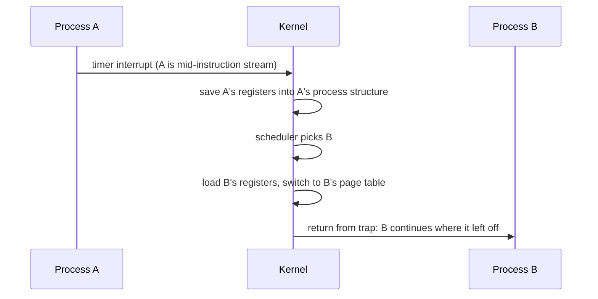

# Context switches and limited direct execution

How can many processes share one CPU, fast, without any of them taking over? OSTEP calls the answer **limited direct execution**.

## Direct execution

Running a program through an interpreter would be safe but slow. So the OS lets the program run **directly on the CPU** at full speed. Two problems:

1. **Restricted operations**: what if it wants to read the disk? It must ask the kernel (a system call).
2. **Getting the CPU back**: what if it never gives up the CPU? The **timer interrupt** forces control back to the kernel.

## A context switch

When the kernel decides to run a different process:



- The switch itself takes about a microsecond. The hidden cost is bigger: B's data isn't in the CPU caches yet, so B runs slower for a while.
- Too many switches waste time; too few make the system feel slow. Day 3 is about that trade-off.

## See it on Linux

```bash
cat /proc/$$/status | grep ctxt
# voluntary_ctxt_switches:    the process blocked (waited for I/O)
# nonvoluntary_ctxt_switches: the kernel took the CPU away (time slice over)

vmstat 1 5     # the "cs" column: context switches per second, whole machine
```

A process with many **voluntary** switches is waiting on I/O a lot. Many **involuntary** switches means it wanted the CPU and kept losing it.

## Optional videos

The lesson above is complete on its own. These lectures go deeper, if you like learning by watching.

**Remzi Arpaci-Dusseau, Lecture 2 part 1: mechanisms of CPU virtualization**

https://www.youtube.com/watch?v=oTd72Yp2m8w

**MIT 6.S081, Lecture 6: Isolation and system call entry and exit**

https://www.youtube.com/watch?v=T26UuauaxWA
