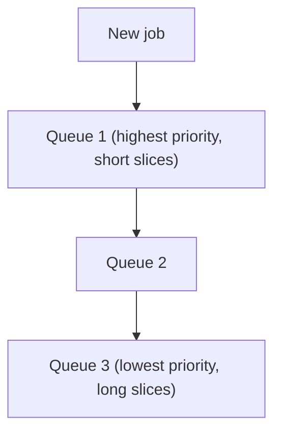

# MLFQ, and how Linux schedules

Real schedulers don't know how long a job will run. They **learn from behaviour**.

## Multi-level feedback queue (MLFQ)



The rules (from OSTEP):

1. Higher-priority queue runs first. Same queue: round robin.
2. A new job starts at the top.
3. If a job uses up its time at a level, it moves **down**. (CPU-hungry jobs sink; interactive jobs that often wait for input stay near the top.)
4. Every so often, move **every** job back to the top (the *priority boost*). This stops starvation and lets a job that became interactive come back up.

MLFQ approximates SJF without knowing job lengths: short and interactive jobs naturally win.

## Linux: fair share

Linux's scheduler for normal processes doesn't use fixed queues. Since 2007 it used **CFS** (the Completely Fair Scheduler), and since kernel 6.6 (2023) it uses **EEVDF**, which keeps the same idea and handles latency better:

- Each runnable task has a **virtual runtime**: how much CPU it has had, weighted by its priority.
- The task that has had the **least** fair share runs next.
- A task that slept (waiting for input) has used little, so it runs quickly when it wakes. That's why your terminal feels responsive even when the CPU is busy.

Priority on Linux is the **nice** value, from −20 (greedy) to 19 (polite):

```bash
nice -n 10 tar czf backup.tgz ~/Documents   # start something politely
renice -n 5 -p 1234                         # change a running process
ps -eo pid,ni,comm | head                   # the NI column
```

Real-time classes (`SCHED_FIFO`, `SCHED_RR`) exist too, for audio and control systems. A runaway real-time task can freeze a machine, so they need privileges.

## The trade-off, stated once

There's no free lunch: **fairness, response time and throughput pull against each other**. Every scheduler is a choice about which matters most for its users.

## Optional videos

The lesson above is complete on its own. These lectures go deeper, if you like learning by watching.

**Remzi Arpaci-Dusseau, Lecture 3 part 1: multi-level feedback queue**

https://www.youtube.com/watch?v=cAiwISFta4g
