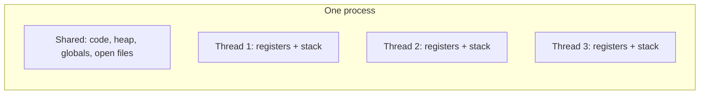
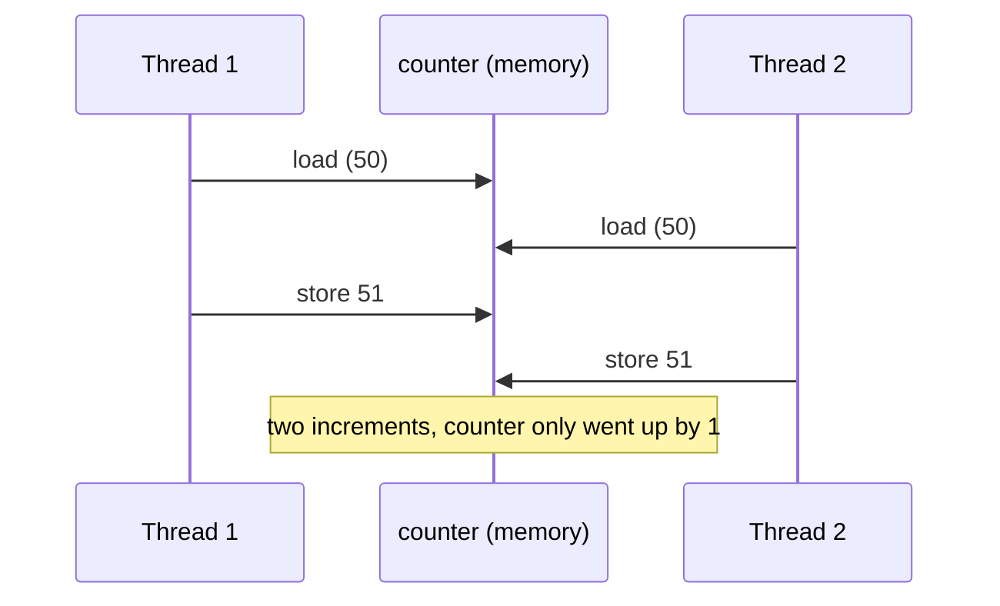

# Threads: concurrency inside one process

A **thread** is a separate flow of execution **inside** a process. Threads in one process share almost everything:

| Shared by all threads | Private to each thread |
|---|---|
| Code, global data, heap | Registers and program counter |
| Open files | Its own **stack** |
| The address space | Thread ID |



## Why threads?

- **Parallelism**: use several CPU cores for one job.
- **Not blocking**: one thread waits for the network while another keeps the UI responsive.
- Cheaper than processes: creating and switching threads costs less, and sharing data is free (but dangerous).

## Concurrency vs parallelism

- **Concurrency**: several tasks in progress at once, maybe taking turns on one core.
- **Parallelism**: several tasks literally running at the same instant on different cores.

## The danger: a race condition

Two threads each run `counter = counter + 1` a million times. You expect 2,000,000. You get something like 1,342,117, different every run. Why? That one line is really three steps:

```text
load counter into a register     (counter = 50)
add 1                            (register = 51)
store register into counter
```



That stretch of code that touches shared data is a **critical section**. Only one thread at a time may be inside it. Tomorrow is about how.

## Kernel and user threads

- **Kernel threads**: the OS schedules each one (Linux threads made with `pthread_create` are these; each gets its own entry in `ps -eLf`).
- **User threads / green threads**: a library switches between them inside one kernel thread (Go goroutines and Python's asyncio are close relatives). Cheap, but a blocking system call can stall them all unless the runtime is careful.

```bash
ps -eLf | head        # one line per thread (LWP = thread id)
ls /proc/$$/task      # the threads of your shell (just one)
```

## Optional videos

The lesson above is complete on its own. These lectures go deeper, if you like learning by watching.

**Remzi Arpaci-Dusseau, Lecture 6 part 1: concurrency and data races**

https://www.youtube.com/watch?v=4PghlMdp9cU

**MIT 6.S081, Lecture 11: Thread switching**

https://www.youtube.com/watch?v=vsgrTHY5tkg
