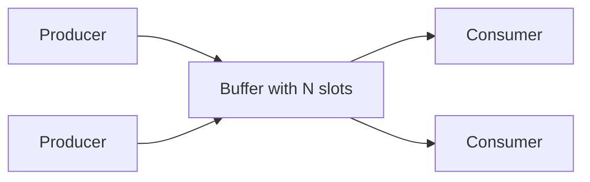

# Condition variables, semaphores and producer/consumer

Locks stop threads from colliding. But threads also need to **wait for each other**: "wait until there's data in the queue". Spinning on a flag wastes CPU. We need a way to sleep until something changes.

## Condition variables

A condition variable is a queue of sleeping threads, always used **with a lock**:

```c
pthread_mutex_lock(&m);
while (count == 0)                  // ALWAYS a while, never an if
    pthread_cond_wait(&filled, &m); // releases m, sleeps, re-takes m when woken
item = take();
pthread_cond_signal(&emptied);
pthread_mutex_unlock(&m);
```

Why `while`? When you wake up, another thread may already have taken the item. Re-check the condition every time. (Spurious wake-ups are allowed too.)

## Producer/consumer (the bounded buffer)



- Producers must wait when the buffer is **full**; consumers wait when it's **empty**.
- Use **two** condition variables (`filled`, `emptied`) so a producer never wakes another producer by mistake.
- This pattern is everywhere: a web server's request queue, `cmd1 | cmd2` in the shell (the pipe is a bounded buffer in the kernel), a logging queue.

## Semaphores

A semaphore is a counter with two atomic operations:

- `wait()` (also called P or down): decrement; if the result is below zero, sleep.
- `post()` (also called V or up): increment; wake one sleeper.

Uses:

| Starting value | Acts as |
|---|---|
| 1 | A lock |
| 0 | "Wait for an event" (the other thread posts when done) |
| N | "At most N at once": N database connections, N buffer slots |

Bounded buffer with semaphores: `empty = N`, `full = 0`, plus a mutex around the buffer itself. **Order matters**: take `empty`/`full` first, then the mutex. Taking the mutex first and then sleeping on a semaphore while holding it is a classic deadlock.

## Optional videos

The lesson above is complete on its own. These lectures go deeper, if you like learning by watching.

**Remzi Arpaci-Dusseau, Lecture 7 part 2: condition variables**

https://www.youtube.com/watch?v=X5clCyJ4uuk

**Remzi Arpaci-Dusseau, Lecture 8 part 1: producer/consumer**

https://www.youtube.com/watch?v=U1LfmL7f1h8

**Remzi Arpaci-Dusseau, Lecture 8 part 2: semaphores**

https://www.youtube.com/watch?v=cuY8r8RXqAY
