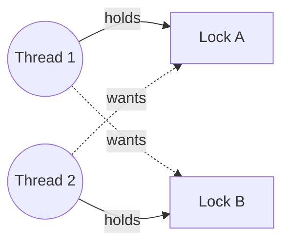

# Deadlock, livelock and concurrency bugs

## Deadlock

Thread 1 holds lock A and wants B. Thread 2 holds B and wants A. Both wait forever.

Deadlock needs **all four** of these at once (the Coffman conditions):

| Condition | Meaning | Break it by |
|---|---|---|
| Mutual exclusion | Resources can't be shared | Lock-free data structures (hard) |
| Hold and wait | Holding one while waiting for another | Take all locks at once, up front |
| No preemption | Can't force a thread to give a lock back | `trylock`: if you can't get the second, release the first and retry |
| **Circular wait** | A cycle of waiting | **Always take locks in the same global order** (the practical fix) |

The everyday rule: decide an order (by address, by name, by level) and always lock in that order. The Linux kernel documents its lock ordering and has a checker (`lockdep`) that complains when code breaks it.

## Livelock

Threads keep **reacting** to each other and never make progress, like two people in a hallway stepping the same way. Typical cause: everyone backs off and retries at the same moment. Fix: random back-off.

## The most common bugs are not deadlocks

A study of real concurrency bugs (MySQL, Apache, Mozilla, OpenOffice) found most were:

- **Atomicity violations**: code assumed two steps happen together, but another thread ran in between ("check, then use": `if (p != NULL) use(p);` while another thread sets `p = NULL`).
- **Order violations**: code assumed A happens before B, but nothing forces it (using a variable before the thread that initializes it has run).

Fix both with a lock or a condition variable that makes the assumption **true**, not just likely.

## Tools

- `htop` and `ps` show threads stuck in state `D` (uninterruptible I/O wait) or `S` (sleeping).
- `gdb -p PID` then `thread apply all bt` shows where every thread is waiting: a deadlock shows up as threads parked in lock calls.
- ThreadSanitizer (`-fsanitize=thread` in GCC/Clang) finds data races automatically.

## Optional videos

The lesson above is complete on its own. These lectures go deeper, if you like learning by watching.

**Remzi Arpaci-Dusseau, Lecture 9 part 1: concurrency bugs**

https://www.youtube.com/watch?v=Fnp_K63ss44

**Remzi Arpaci-Dusseau, Lecture 9 part 2: deadlock**

https://www.youtube.com/watch?v=AMG29dlH8t0
