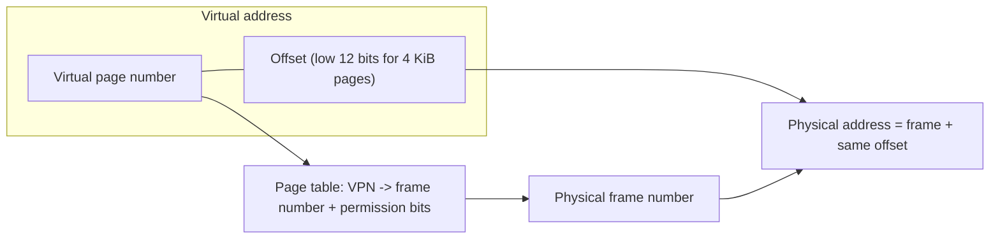

# Address spaces and address translation

Every process believes it has its own memory starting at address 0. The OS and the CPU's **memory management unit (MMU)** make that true by **translating** every address the program uses (a *virtual* address) into a real location in RAM (a *physical* address).

## Why bother?

- **Isolation**: process A can't even name process B's memory.
- **Convenience**: every program is compiled as if it owns the machine.
- **Efficiency**: memory that isn't used doesn't need to be in RAM at all.

## The early ideas (and why they weren't enough)

| Method | How | Problem |
|---|---|---|
| **Base and bounds** | Physical = virtual + base; refuse if beyond bounds | The whole address space must sit in one block, including the empty gap between heap and stack |
| **Segmentation** | Separate base/bounds for code, heap, stack | Memory gets chopped into odd-sized holes (**external fragmentation**) |

## Paging

Split virtual memory into fixed-size **pages** (usually 4 KiB) and physical memory into **frames** of the same size. Any page can go in any frame. A **page table** per process records where.

Each page table entry also holds bits that matter a lot:

- **Valid / present**: is this page mapped (and in RAM)?
- **Read / write / execute**: what's allowed. Writing to code or running data raises a fault.
- **User**: may user mode touch it? Kernel pages are mapped but not user-accessible.
- **Accessed / dirty**: set by hardware when the page is used or written, which helps the OS decide what to evict.

## The TLB: making it fast

Looking up the page table on every memory access would double the cost of every load. The CPU caches recent translations in the **TLB** (translation lookaside buffer).

- TLB hit: translation in about one cycle.
- TLB miss: walk the page table (slower), then cache the result.
- Programs that touch memory in order hit the TLB almost always. Jumping randomly across huge data misses a lot, which is why databases use **huge pages** (2 MiB) to cover more memory per TLB entry.
- On a context switch, the TLB entries of the old process are useless. Modern CPUs tag entries with an address-space ID so they don't all need flushing.

## Optional videos

The lesson above is complete on its own. These lectures go deeper, if you like learning by watching.

**Remzi Arpaci-Dusseau, Lecture 3 part 2: dynamic relocation**

https://www.youtube.com/watch?v=I0RIlSN0DzM

**Remzi Arpaci-Dusseau, Lecture 4 part 2: paging**

https://www.youtube.com/watch?v=7BOXM2XgGO4

**Remzi Arpaci-Dusseau, Lecture 4 part 3: TLBs**

https://www.youtube.com/watch?v=LprKOBsALGA

**MIT 6.S081, Lecture 4: Page tables**

https://www.youtube.com/watch?v=f1Hpjty3TT8
