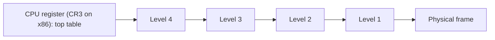

# Multi-level page tables, page faults and swapping

## Page tables are big, so they're trees

A 48-bit address space with 4 KiB pages has 2^36 pages. A flat table with 8 bytes per entry would be 512 GiB per process. Nobody does that.

Instead, x86-64 uses **four levels** (five on some new CPUs). The top table points to second-level tables, and so on. Parts of the address space that aren't used simply have no lower-level tables. A small process needs only a few pages of page tables.



A TLB miss means up to four memory reads. That's why the TLB matters so much.

## Page faults

When a program touches a page whose entry says "not present", the CPU raises a **page fault** and the kernel decides what it means:

| Situation | Kind | What the kernel does |
|---|---|---|
| Page was never touched yet (fresh heap, stack growth) | Minor | Give it a zeroed frame, map it, retry |
| Page is part of a file not yet read (code of a program you just started) | Major | Read it from disk, map it, retry |
| Page was swapped out | Major | Read it back from swap, retry |
| Write to a shared copy-on-write page (after `fork`) | Minor | Copy the page, give the writer its own copy |
| Address that isn't part of the process at all | Error | Send the process `SIGSEGV`: segmentation fault |

This is **demand paging**: nothing is loaded until it's touched. It's also why `fork()` is cheap: parent and child share pages until one of them writes (**copy-on-write**).

## Swapping and page replacement

When RAM is full, the OS evicts pages. Which ones? Ideally the ones not needed for the longest time. Real systems approximate **least recently used (LRU)** using the hardware's *accessed* bits (the "clock" algorithm and its relatives).

- Clean file pages (code, cached files) can just be dropped: they're on disk already.
- Dirty anonymous pages (heap) must be written to **swap** first.
- If the working set of running programs doesn't fit in RAM, the system **thrashes**: it spends its time moving pages, and everything crawls. Linux's last resort is the **OOM killer**, which kills a process to free memory.

## On Linux

```bash
free -h                      # used, free, buff/cache, available, swap
vmstat 1 5                   # si/so: swap in/out per second. Non-zero and steady = trouble
cat /proc/$$/status | grep -E 'VmRSS|VmSize'   # resident vs virtual size
/usr/bin/time -v ls 2>&1 | grep -i fault       # major and minor faults of one command
cat /proc/meminfo | head -20
```

`available` in `free` is the number that matters: it counts cache the kernel can give back. A box with "only 200 MB free" but 6 GB available is fine.

## Optional videos

The lesson above is complete on its own. These lectures go deeper, if you like learning by watching.

**Remzi Arpaci-Dusseau, Lecture 5 part 1: multi-level page tables**

https://www.youtube.com/watch?v=ggPkFxOTwHY

**Remzi Arpaci-Dusseau, Lecture 5 part 2: swapping**

https://www.youtube.com/watch?v=4tPXkN5nRQs

**MIT 6.S081, Lecture 8: Page faults**

https://www.youtube.com/watch?v=KSYO-gTZo0A
