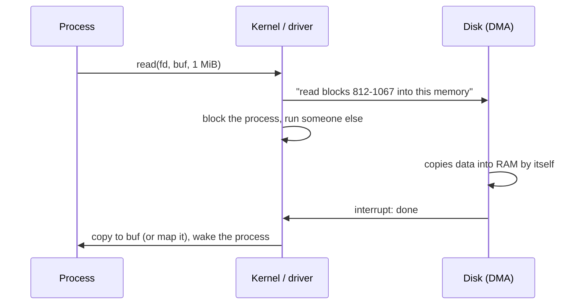

# Devices, drivers, interrupts and DMA

## How the CPU talks to a device

A device has a small set of **registers** (status, command, data). The OS reads and writes them, either with special I/O instructions or, more often, through memory addresses that are wired to the device (**memory-mapped I/O**).

A **device driver** is the kernel code that knows one device's registers. It presents a standard interface upward ("read block 812") so the rest of the kernel doesn't care which disk you have. Drivers are most of the Linux kernel's code, and a buggy driver can crash the whole system, because it runs in kernel mode.

## Waiting for a device: polling vs interrupts

| Method | How | Good when |
|---|---|---|
| **Polling** | Keep checking the status register | The device answers almost instantly |
| **Interrupts** | Start the work, run another process, the device interrupts when done | The device is slow (disk, network, keyboard) |

Very fast devices (high-speed network cards, NVMe drives) flood the CPU with interrupts, so drivers switch to polling under heavy load (Linux's NAPI for networking does exactly this).

## DMA: let the device move the data

Copying a 1 MiB disk read word by word would waste the CPU. With **DMA** (direct memory access), the driver tells the device "put the data at this physical address", and the device writes RAM itself, then raises one interrupt when it's done.



## Blocking and non-blocking I/O

- **Blocking** (the default): `read()` doesn't return until data is there. Simple; one thread per connection.
- **Non-blocking**: `read()` returns at once with "nothing yet" (`EAGAIN`). Combined with `epoll` (Linux) or `kqueue` (BSD/macOS), one thread can watch thousands of connections. This is how nginx and Node.js handle huge numbers of clients.
- **Asynchronous**: submit many requests, collect results later. Linux's modern interface for this is `io_uring`.

## Buffering and caching

- The kernel keeps recently read file data in RAM (the **page cache**). The second `cat bigfile` is much faster than the first.
- Writes usually go into the page cache and reach the disk a little later. `sync` or `fsync()` force them out; databases call `fsync` on commit for exactly this reason.

```bash
cat /proc/interrupts | head    # interrupts per CPU per device
lspci -k | head -30            # PCI devices and the driver each one uses
lsmod | head                   # loaded kernel modules (most are drivers)
```

## Optional videos

The lesson above is complete on its own. These lectures go deeper, if you like learning by watching.

**MIT 6.S081, Lecture 9: Interrupts**

https://www.youtube.com/watch?v=zRnGNndcVEA
