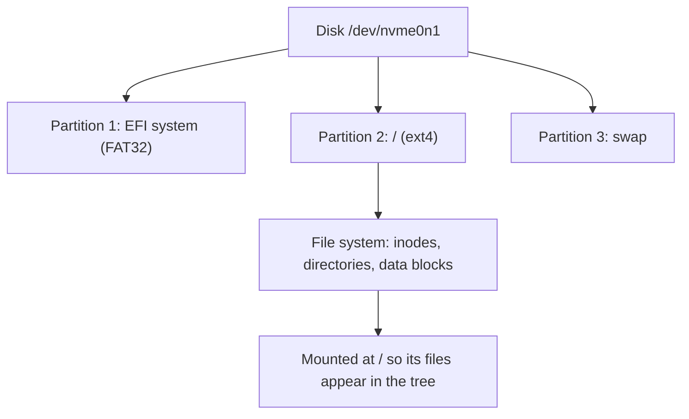

# Storage: hard drives, SSDs, partitions and RAID

## Block devices

Disks are **block devices**: the OS reads and writes them in fixed-size blocks (sectors of 512 bytes or 4 KiB), addressed by number. Everything above (partitions, file systems, databases) is built on "read block N, write block N".

## Hard drives

A hard drive is spinning platters and a moving arm. One random read costs:

- **Seek**: move the arm, a few milliseconds.
- **Rotation**: wait for the sector to come round, a few milliseconds.
- **Transfer**: read it, very fast.

So: **sequential** reads are about 100 times faster than random ones. That one fact shaped decades of file system design. Disk schedulers reorder requests to cut seek time (elevator-style algorithms like SCAN/C-SCAN).

## SSDs

No moving parts, so random reads are fast. But flash has quirks:

- You can write a page only after erasing a much larger **block**.
- Each block survives a limited number of erase cycles.
- The SSD's own firmware (the **flash translation layer**) remaps writes and spreads wear, much like the virtual memory you just learned.
- The OS tells the SSD which blocks are free with **TRIM** (`fstrim`), which keeps it fast.

With NVMe SSDs, Linux usually uses the `none` I/O scheduler: the drive is faster than any reordering would help.

## Partitions and mount points



- A **partition table** (GPT today, MBR on old systems) splits a disk into regions.
- Each region gets a **file system** (ext4, XFS, Btrfs on Linux; NTFS on Windows; APFS on macOS).
- Linux has one tree starting at `/`. **Mounting** attaches a file system at a directory.

## RAID: many disks as one

| Level | Idea | Survives | Space you get |
|---|---|---|---|
| RAID 0 | Stripe data across disks | Nothing: one disk dies, all data gone | 100% |
| RAID 1 | Mirror | One disk (per mirror) | 50% |
| RAID 5 | Stripe + parity spread across disks | One disk | (N−1)/N |
| RAID 6 | Two parity blocks | Two disks | (N−2)/N |
| RAID 10 | Mirrors, striped | One per mirror pair | 50% |

**RAID is not a backup.** Delete a file and RAID faithfully deletes it everywhere.

```bash
lsblk -f        # disks, partitions, file systems, mount points
findmnt         # what is mounted where
df -h           # space used per mounted file system
cat /sys/block/*/queue/scheduler    # the I/O scheduler of each disk
```

## Optional videos

The lesson above is complete on its own. These lectures go deeper, if you like learning by watching.

**Remzi Arpaci-Dusseau, Lecture 10 part 1: hard disk drives**

https://www.youtube.com/watch?v=SQz2CTpI-NM

**Remzi Arpaci-Dusseau, Lecture 11 part 1: RAID**

https://www.youtube.com/watch?v=XF0mKxLrSVs

**Remzi Arpaci-Dusseau, Lecture 14 part 3: flash-based SSDs**

https://www.youtube.com/watch?v=vvttbstRdj8
