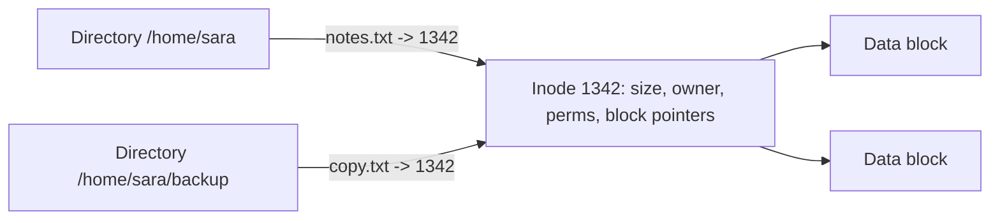

# Files, directories, inodes and file descriptors

## What a file really is

On Unix file systems a file is an **inode**: a numbered record holding the file's **metadata** and where its data blocks are. The name is **not** in the inode.

| Inode holds | Inode does NOT hold |
|---|---|
| Type (file, directory, link, device) | The file's name |
| Size, owner, group, permissions | Which directory it's in |
| Timestamps (modified, changed, accessed) | |
| Link count | |
| Pointers to data blocks | |

A **directory** is just a special file: a list of `name -> inode number` pairs.



## Hard links and symbolic links

- A **hard link** is another directory entry pointing to the **same inode** (above: `notes.txt` and `copy.txt` are the same file). The data is freed only when the link count reaches 0 and nobody has it open. Hard links can't cross file systems or point at directories.
- A **symbolic link** is a tiny file whose content is a **path**. It can point anywhere, even to nothing (a dangling link).

```bash
ls -li                     # first column: inode numbers
ln notes.txt hard.txt      # same inode, link count goes to 2
ln -s notes.txt soft.txt   # new inode containing the text "notes.txt"
stat notes.txt             # everything the inode says
```

## File descriptors: an open file

When a process calls `open()`, the kernel returns a small number, the **file descriptor**, and keeps three layers:


- `read(fd, buf, n)` and `write(fd, buf, n)` move the **offset** forward.
- After `fork()`, parent and child share the open file entry, so they share the offset (that's why both can write to the same log without overwriting each other).
- Deleting a file that a process still has open frees the name, not the data. Disk space comes back only when the process closes it. "`df` says the disk is full but `du` can't find the files" is often exactly this: `lsof +L1` shows them.

```bash
ls -l /proc/$$/fd          # your shell's open file descriptors
lsof -p $$ | head          # same, with more detail
```

## Everything is a file (almost)

Devices (`/dev/sda`, `/dev/null`), pipes, sockets and kernel information (`/proc`, `/sys`) all show up through the same open/read/write interface. The **VFS** (virtual file system) layer in the kernel makes them all look alike, so `cat` works on a real file, a device, and `/proc/cpuinfo` without knowing the difference.

## Optional videos

The lesson above is complete on its own. These lectures go deeper, if you like learning by watching.

**Remzi Arpaci-Dusseau, Lecture 11 part 3: the file system API**

https://www.youtube.com/watch?v=Mn9g9XWec28

**Remzi Arpaci-Dusseau, Lecture 11 part 4**

https://www.youtube.com/watch?v=EDFoFlzZ8_w
