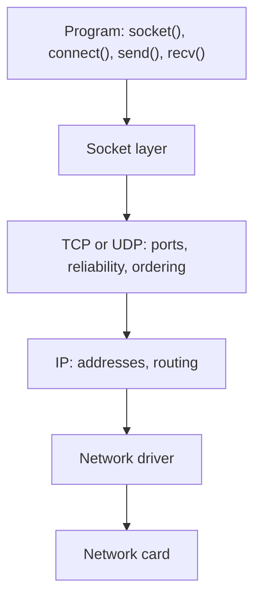

# Networking as an OS service: sockets

Your program never talks to the network card. It talks to the kernel's **network stack** through **sockets**, which look a lot like files.



## A TCP server and client, as system calls

```text
Server                               Client
socket()                             socket()
bind(port 8080)
listen()
accept()   <---- three-way handshake ---- connect(server, 8080)
read()/write()  <------ data ------>  write()/read()
close()                              close()
```

- `accept()` returns a **new** socket (a new file descriptor) for each client; the listening socket stays open for the next one.
- `read()` on a socket blocks until data arrives, exactly like reading a slow file. Day 7's non-blocking I/O and `epoll` apply here too.

## TCP vs UDP

| | TCP | UDP |
|---|---|---|
| Connection | Yes (handshake) | No |
| Delivery | Reliable, in order, retransmits lost data | Best effort: may lose or reorder |
| Shape | A stream of bytes | Separate messages (datagrams) |
| Used by | Web (HTTP/1, HTTP/2), SSH, databases | DNS, video calls, games, QUIC (HTTP/3) |

## Ports

A port (0 to 65535) picks which socket on a machine gets the data. A connection is identified by four numbers: source IP, source port, destination IP, destination port. Ports below 1024 need privileges to bind on Linux.

## See it

```bash
ss -tlnp            # TCP sockets listening, with the process that owns each
ss -tn              # current TCP connections
cat /proc/net/tcp | head -3     # the same data, raw, straight from the kernel
python3 -m http.server 8080 &   # start a tiny server, then:
curl -s localhost:8080 | head -3
kill %1
```

The full story of IP, routing and DNS is the Networking Fundamentals course. The point here: networking is just another kernel service behind system calls and file descriptors.

## Optional videos

The lesson above is complete on its own. These lectures go deeper, if you like learning by watching.

**MIT 6.S081, Lecture 21: Networking**

https://www.youtube.com/watch?v=Fcjychg4Tvk
