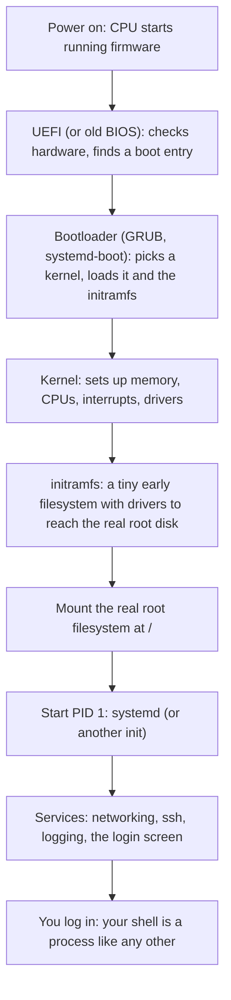

# Boot, the kernel and the first process



## Each step's job

| Stage | Job | When it breaks |
|---|---|---|
| Firmware | Find a bootable disk | "No bootable device" |
| Bootloader | Load the kernel and initramfs, pass kernel options | A GRUB prompt instead of a menu |
| Kernel | Bring up hardware and core services | **Kernel panic** |
| initramfs | Load the drivers needed to reach `/` (RAID, LVM, encryption) | Dropped into an emergency shell |
| PID 1 | Start and supervise everything else | A failed service, a stuck boot |

## PID 1 is special

- It's the ancestor of every user process.
- If it dies, the kernel panics.
- Orphaned processes (whose parent died) are re-parented to it, and it reaps their zombies.
- On most Linux distributions it's **systemd**, which starts services in parallel, restarts them when they crash, and collects their logs.

```bash
ps -p 1 -o pid,comm          # what is PID 1 here?
systemd-analyze              # how long boot took
systemd-analyze blame | head # which services were slow
cat /proc/cmdline            # the options the bootloader gave the kernel
journalctl -b -k | head      # kernel messages from this boot
```

## Where kernels differ

- **Monolithic** kernels (Linux): file systems, drivers and networking all run in kernel mode. Fast, but one bug can take everything down. Loadable **modules** add drivers at runtime.
- **Microkernels** (seL4, QNX, MINIX): only the basics in the kernel; drivers and file systems are normal processes. Safer, with more message passing.
- **Hybrids** (Windows NT, macOS XNU) sit in between.

## Optional videos

The lesson above is complete on its own. These lectures go deeper, if you like learning by watching.

**MIT 6.S081, Lecture 18: OS organization (monolithic vs microkernels)**

https://www.youtube.com/watch?v=dM9PLdaTpnA
