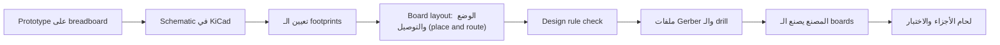

# ما هو الـ PCB

الـ **printed circuit board** ‏(PCB) هو اللوح الأخضر (أو الأزرق أو الأسود أو الأحمر) الموجود داخل كل جهاز إلكتروني تقريبًا. يحمل الأجزاء ويوصلها بـ tracks نحاسية بدل الأسلاك السائبة. الـ breadboards لتجربة الأفكار؛ والـ PCBs للأشياء التي تدوم، وتدخل في علبة، ويمكن تصنيعها بالمئات.

هذا الكورس يأخذك من دائرة على breadboard إلى board حقيقي تطلبه من مصنع، باستخدام **KiCad**، وهو برنامج تصميم مجاني واحترافي ومفتوح المصدر. يجب أن تعرف أساسيات الإلكترونيات أولًا (كورس *أساسيات الإلكترونيات*، أو ما يشبهه).

## داخل الـ board

| الطبقة | ما هي | لماذا |
|---|---|---|
| **FR-4 core** | ألياف زجاجية وإيبوكسي، عادة سمكها 1.6 mm | القاعدة الصلبة |
| **Copper** | ألواح نحاس رقيقة (35 µm، أي "1 oz") على وجه أو وجهين | "الأسلاك": الـ tracks والـ pads ومساحات الـ ground |
| **Solder mask** | الطبقة الملونة | تعزل النحاس وتمنع انتشار اللحام |
| **Silkscreen** | الكتابة البيضاء | أسماء الأجزاء (R1 وC3)، والحدود، والتسميات، والشعار الخاص بك |

الـ boards الصغيرة عادة لها **طبقتا copper** ‏(top وbottom). والـ boards المعقدة (الموبايلات والكمبيوترات) لها من 4 إلى 12 طبقة أو أكثر، بعضها في الداخل.

## الكلمات التي ستستخدمها كل يوم

- **Track** ‏(trace): خط نحاسي يوصل نقطتين.
- **Pad**: نحاس مكشوف يُلحم عليه pin الجزء.
- **Via**: ثقب صغير مطلي يوصل track على طبقة بطبقة أخرى.
- **Footprint**: نمط الـ pads ‏(والحدود) لجزء واحد، مطابق لـ pins الحقيقية.
- **THT** ‏(through-hole): أجزاء أرجلها تمر في ثقوب، سهلة اللحام باليد.
- **SMD/SMT** ‏(surface mount): أجزاء صغيرة تُلحم على pads على السطح؛ وأغلب الـ boards الحديثة تستخدمها.
- **Net**: مجموعة pins يجب أن تتصل كلها (مثلًا كل pins الـ GND).
- **Ground plane** ‏(pour): مساحة نحاس كبيرة متصلة بالـ ground.

## من الفكرة إلى الـ board

1. **الـ Schematic**: ارسم الدائرة بالرموز. وهذا يحدد **ما** المتصل بماذا.
2. **الـ Footprints**: اختر الـ package الفعلي لكل جزء.
3. **الـ Layout**: ضع الـ footprints على شكل الـ board وارسم الـ tracks النحاسية. وهذا يحدد **أين**.
4. **الفحوص**: دع KiCad يجد الأخطاء (pins غير موصلة، tracks قريبة جدًا).
5. **ملفات التصنيع**: ملفات Gerber تصف كل طبقة؛ وملف drill يذكر الثقوب.
6. **الطلب**: ارفعها لمصنع PCB. والطلبات الصغيرة من 5 أو 10 boards رخيصة وتصل في أسبوع أو اثنين.
7. **التجميع والاختبار**: الحم الأجزاء وتأكد أن الـ board يعمل.

## لماذا كل هذا؟

- **الموثوقية**: لا jumper wires سائبة؛ يعمل بنفس الطريقة في كل مرة تمسكه.
- **الحجم**: أجزاء SMD على PCB تأخذ جزءًا صغيرًا من مساحة الـ breadboard.
- **التكرار**: اطلب 100 board متطابق.
- **مهارة مهنية**: تصميم الـ PCB مهارة أساسية في وظائف الـ hardware والروبوتات والـ IoT والـ embedded systems.

## الخلاصة

- الـ PCB طبقات من FR-4 وcopper وsolder mask وsilkscreen؛ والـ tracks والـ pads والـ vias تحل محل الأسلاك.
- ‏Schematic (ما المتصل) ← footprints ← layout (أين) ← فحوص ← Gerbers ← المصنع.
- ‏KiCad مجاني واحترافي؛ وهذا الكورس يستخدمه من البداية للنهاية.

## فيديوهات اختيارية

الدرس أعلاه كامل وحده. هذه الفيديوهات للتعمق إن كنت تحب التعلم بالمشاهدة. الفيديوهات المكتوب بجانبها (بالإنجليزية) يمكنك تشغيل الترجمة لها (**CC**)، ثم **الإعدادات ← الترجمة ← ترجمة تلقائية ← العربية**.

**An intro to KiCad, part 1: how PCBs are made (DigiKey) (بالإنجليزية)**

https://www.youtube.com/watch?v=vaCVh2SAZY4
