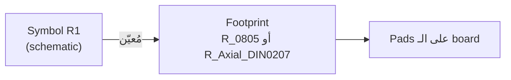

# البداية مع KiCad

## التثبيت

نزّل KiCad من **kicad.org** ‏(Windows وmacOS وLinux). هذا الكورس يستخدم **KiCad 10**؛ وKiCad 9 يعمل بنفس الطريقة تقريبًا. والتحميل كبير لأنه يتضمن آلاف الـ symbols والـ footprints والـ 3D models الجاهزة.

على Linux تستطيع أيضًا استخدام package التوزيعة أو الـ Flatpak من Flathub.

## الـ Project

افتح KiCad واختر **File → New Project**. سمّه اسمًا مثل `led-flasher`. يُنشئ KiCad مجلدًا فيه:

```text
led-flasher/
  led-flasher.kicad_pro    project settings
  led-flasher.kicad_sch    the schematic
  led-flasher.kicad_pcb    the board
```

احتفظ بكل ما يخص board واحدًا في مجلده الخاص، وضعه تحت **git** (كلها ملفات نصية)، لكي تستطيع الرجوع دائمًا.

## الأدوات الرئيسية

من نافذة الـ project تفتح المحررات:

| الأداة | ماذا تفعل فيها |
|---|---|
| **Schematic Editor** | ترسم الدائرة بالـ symbols والأسلاك |
| **Symbol Editor** | تصنع symbol لجزء غير موجود في المكتبة |
| **PCB Editor** | تضع الـ footprints وتوصل الـ tracks النحاسية |
| **Footprint Editor** | تصنع footprints أو تعدلها |
| **Gerber Viewer** | تراجع الملفات التي سترسلها للمصنع |
| **Calculator Tools** | عرض الـ tracks وقيم الـ resistors والـ regulators وغيرها |

## الـ Symbols مقابل الـ footprints

هذا الفرق يوقع كل مبتدئ:

- الـ **symbol** هو الرسم في الـ schematic: خط resistor متعرج له pinان. لا يقول شيئًا عن الحجم.
- الـ **footprint** هو نمط النحاس على الـ board: ‏padان بينهما 7.6 mm لـ resistor ‏through-hole، أو padان صغيران جدًا لـ resistor ‏SMD بمقاس 0603.

‏symbol واحد (resistor) يمكن أن يستخدم footprints كثيرة. وتربط الاثنين في خطوة "assign footprints"، ويحافظ KiCad على الربط بينهما: غيّر الـ schematic، ثم حدّث الـ board.



## التحرك في البرنامج

الاختصارات التي ستستخدمها باستمرار (في المحررين):

| المفتاح | الفعل |
|---|---|
| A | إضافة symbol ‏(schematic) |
| W | رسم سلك (schematic) |
| X | توصيل track ‏(PCB) |
| M / G | نقل / سحب (يبقي الأسلاك متصلة) |
| R | تدوير |
| E | تعديل خصائص العنصر تحت الماوس |
| Delete | حذف |
| Ctrl+Z | تراجع |
| عجلة الماوس | تكبير؛ والسحب بالزر الأوسط أو الأسهم للتحريك |

اضغط **Ctrl+F1** ‏(أو **?**) في أي محرر لترى القائمة كاملة.

## إعدادات تستحق التغيير أولًا

- **Preferences → Common → Units**: الملليمترات (أغلب المصانع والـ datasheets تستخدم mm).
- في الـ PCB Editor، **File → Board Setup → Design Rules**: ستضبطها من حدود المصنع في الوحدة 4.
- شغّل الـ **autosave** في Preferences.

## المكتبات

مكتبات KiCad المدمجة تغطي أغلب الأجزاء الشائعة: ‏resistors وcapacitors وLEDs وconnectors والـ chips المشهورة. وعندما ينقص جزء:

1. ابحث في الخدمات الأونلاين التي تقدم symbols وfootprints لـ KiCad لأرقام أجزاء محددة (مثلًا صفحات الأجزاء في SnapEDA أو Ultra Librarian أو موقع أجزاء LCSC/JLCPCB).
2. أو ارسمه بنفسك في محرري الـ Symbol والـ Footprint، باستخدام **package drawing** في الـ datasheet الخاص بالجزء. والوحدة 2 تبيّن كيف.

تحقق دائمًا من أي footprint منزّل مقابل مقاسات الـ datasheet قبل طلب الـ boards.

## الخلاصة

- ثبّت KiCad 10 من kicad.org؛ وكل board هو مجلد project ‏(احتفظ به في git).
- الـ Schematic Editor للـ symbols والأسلاك، والـ PCB Editor للـ footprints والـ tracks.
- الـ symbols تقول ما المتصل؛ والـ footprints هي الـ pads الفعلية؛ وتربطهما قبل الـ layout.

## فيديوهات اختيارية

الدرس أعلاه كامل وحده. هذه الفيديوهات للتعمق إن كنت تحب التعلم بالمشاهدة. الفيديوهات المكتوب بجانبها (بالإنجليزية) يمكنك تشغيل الترجمة لها (**CC**)، ثم **الإعدادات ← الترجمة ← ترجمة تلقائية ← العربية**.

**KiCad 9.0 getting started, part 1: intro and download (DigiKey) (بالإنجليزية)**

https://www.youtube.com/watch?v=0WCi1rhueH4
