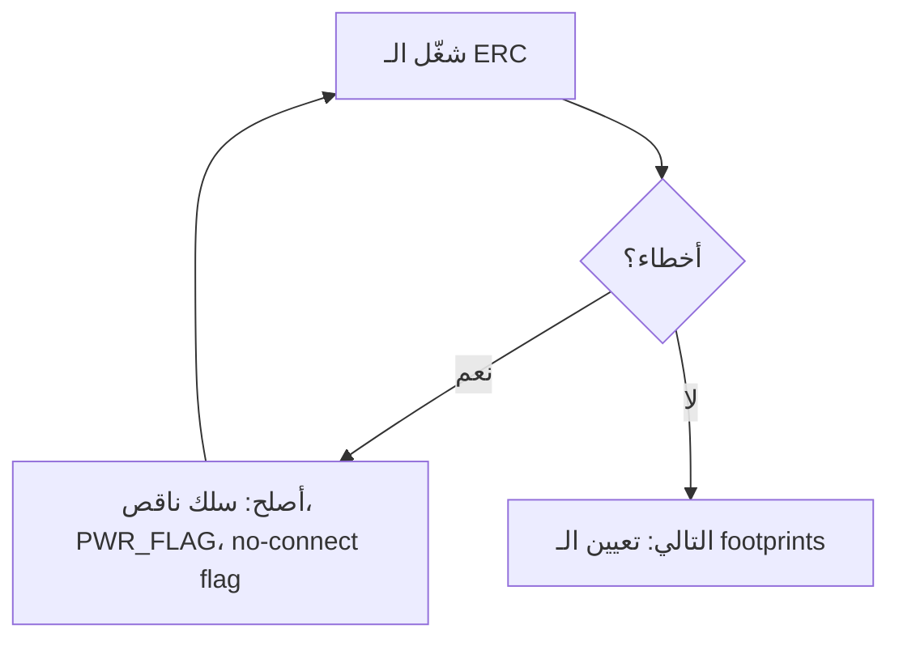

# رسم الـ schematic

سنصمم board واحدًا عبر هذا الكورس: **الـ 555 LED flasher** من كورس الإلكترونيات، يعمل ببطارية 9 V أو بـ USB ‏5 V. ابنِه على breadboard أولًا إن استطعت؛ فالـ board الذي ينسخ prototype يعمل احتماله أكبر بكثير أن يعمل من أول مرة.

## وضع الـ symbols

في الـ Schematic Editor اضغط **A** وابحث:

| اسم الـ symbol في KiCad | الجزء |
|---|---|
| `NE555P` ‏(مكتبة Timer) | ‏555 timer، ‏DIP-8 |
| `R` | ‏resistor ‏(×3) |
| `C` | ‏capacitor ‏(10 nF) |
| `C_Polarized` | ‏electrolytic ‏10 µF |
| `LED` | ‏LED |
| `Conn_01x02` | ‏connector بـ pinين للكهرباء |
| `+9V` و`GND` ‏(power symbols) | تسميات المصدر والـ ground |

ضعها تقريبًا في أماكنها في الرسم. اضغط **R** للتدوير، و**M** للنقل.

## التوصيل

اضغط **W**، وانقر على طرف pin، ثم انقر على الـ pin الآخر. والنقطة الخضراء تبيّن junction ‏(ثلاثة أسلاك أو أكثر تلتقي). نصائح:

- الأسلاك تتصل فقط عند **أطراف الـ pins** و**نقاط الـ junction**. الأسلاك المتقاطعة بدون نقطة غير متصلة.
- استخدم **power symbols** ‏(`+9V` و`GND`) بدل الأسلاك الطويلة: كل symbol ‏`GND` هو نفس الـ net، أينما كان على الصفحة.
- استخدم **net labels** ‏(اضغط **L**) لتسمية الإشارات مثل `OUT` أو `TRIG`: ‏labelان بنفس الاسم متصلان. وهي تجعل الـ schematics الكبيرة سهلة القراءة.

## الترقيم وضبط القيم

1. **Annotate** ‏(Tools → Annotate Schematic): يرقّم KiCad الأجزاء R1 وR2 وC1...
2. اضبط **قيمة** كل جزء: ضع الماوس عليه واضغط **V**. ‏R1 = 1k، وR2 = 68k، وR3 = 470، وC1 = 10µ، وC2 = 10n.

الـ schematics الجيدة تُقرأ من اليسار لليمين (من المدخلات للمخرجات)، والكهرباء في الأعلى والـ ground في الأسفل، تمامًا مثل الرسم أعلاه.

## الـ Power flags والـ ERC

شغّل **Electrical Rules Check** ‏(Inspect → Electrical Rules Checker). وهو يكتشف:

- pins تُركت غير موصلة بالخطأ
- مخرجات متصلة بمخرجات
- "power input pin not driven": ‏KiCad لا يعرف أن الـ +9V يأتي من الـ connector

أصلح الأخيرة بوضع symbol ‏**PWR_FLAG** على الـ nets ‏+9V وGND. وهو يخبر KiCad "الكهرباء تدخل من هنا". وعلّم الـ pins التي تريدها فعلًا غير موصلة بالـ **no-connect flag** ‏(Q).

لا تنتقل حتى يصبح الـ ERC نظيفًا، أو تفهم كل تحذير وتقبله.

## أضف الـ decoupling capacitor

قد تكون نسخة الـ breadboard عملت بدونه، لكن كل chip على PCB يأخذ capacitor ‏**100 nF** بين pins الـ VCC والـ GND. أضف C3 = 100n الآن. وعلى الـ board ستضعه بجوار الـ pin ‏8 للـ 555 مباشرة.

## الخلاصة

- ضع الـ symbols بـ A، ووصّل بـ W؛ واستخدم الـ power symbols والـ net labels بدل الأسلاك الطويلة.
- رقّم، واضبط القيم، وأضف PWR_FLAGs، وشغّل الـ ERC حتى يصبح نظيفًا.
- أضف decoupling capacitor ‏100 nF لكل chip، حتى لو عمل الـ breadboard بدونه.

## فيديوهات اختيارية

الدرس أعلاه كامل وحده. هذه الفيديوهات للتعمق إن كنت تحب التعلم بالمشاهدة. الفيديوهات المكتوب بجانبها (بالإنجليزية) يمكنك تشغيل الترجمة لها (**CC**)، ثم **الإعدادات ← الترجمة ← ترجمة تلقائية ← العربية**.

**KiCad 9.0 getting started, part 2: schematic layout (DigiKey) (بالإنجليزية)**

https://www.youtube.com/watch?v=0Q6gU7-QqUg

**KiCad 9.0 getting started, part 3: create a custom schematic symbol (DigiKey) (بالإنجليزية)**

https://www.youtube.com/watch?v=0MqHR6cU_y0
