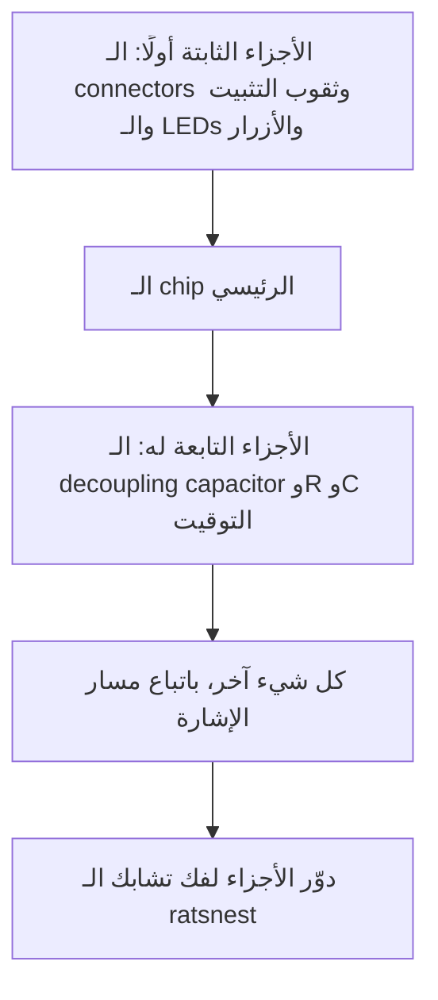

# الـ Board layout: الحدود ووضع الأجزاء

افتح الـ **PCB Editor** واضغط **F8** ‏(Tools → Update PCB from Schematic). كل الـ footprints تظهر في كومة، تربطها خطوط رفيعة اسمها **الـ ratsnest**: كل خط يبيّن توصيلة ما زال عليك عملها بالنحاس.

## حدود الـ board

ارسم شكل الـ board على طبقة **Edge.Cuts**: اختر Edge.Cuts في لوحة الطبقات، ثم ارسم مستطيلًا (الأركان المستديرة أجمل شكلًا وملمسًا). ولهذا الـ flasher، ‏30 × 25 mm أكثر من كافية.

فكّر في العلبة أولًا: أين تذهب ثقوب التثبيت (مسامير M3 شائعة؛ الـ footprint ‏`MountingHole:MountingHole_3.2mm_M3`)، وأي حافة يجب أن يواجهها connector الكهرباء؟

## وضع الأجزاء هو الأهم

الوضع الجيد يجعل التوصيل سهلًا؛ والوضع السيئ يجعله مستحيلًا. ترتيب جيد:

قواعد عامة:

- الـ **decoupling capacitors** توضع أقرب ما يمكن إلى pin الكهرباء الذي تخدمه (C3 بجوار الـ pin ‏8 للـ 555 مباشرة).
- اجعل الأجزاء المتصلة ببعضها **قريبة من بعض**، واتبع الإشارة: المدخل على جانب، والمخرج على الجانب الآخر.
- صفّ الأجزاء في نفس الاتجاه. فيسهل فحصها وتجميعها ولحامها.
- اترك مساحة حول الـ connectors للأصابع والفيش.
- راقب الـ ratsnest: عندما تتقاطع الخطوط كثيرًا، دوّر (**R**) أو انقل الأجزاء حتى تصبح الخطوط مستقيمة في أغلبها.

## الـ Courtyards

لكل footprint ‏**courtyard** ‏(خط رفيع على طبقة F.Courtyard): المساحة التي يحتاجها الجزء، ومعها مكان للحام. ولا يجب أن تتداخل الـ courtyards. والـ design rule check سيكتشف التداخلات لاحقًا.

## الـ Silkscreen

اجعل الـ silkscreen مفيدًا:

- الـ reference designators ‏(R1 وC3) مقروءة، وليست تحت الأجزاء، وكلها في نفس الاتجاه.
- علّم **+** و**−** عند connector الكهرباء، والـ pin رقم 1 للـ chips، وpolarity الـ LED.
- أضف اسم الـ board والإصدار والتاريخ (مثلًا `LED flasher v1.0 2026-11`). وعندما يكون على مكتبك ثلاثة إصدارات، ستكون سعيدًا بذلك.

## تحقق بالـ 3D

**View → 3D Viewer** ‏(Alt+3) يعرض الـ board بأجزاء تبدو حقيقية. وهي أسرع طريقة لاكتشاف جزء متجه للاتجاه الخطأ، أو connector خارج عن الحافة، أو capacitor طويل في مكان الغطاء.

## الخلاصة

- حدّث الـ PCB من الـ schematic ‏(F8)؛ وارسم الحدود على Edge.Cuts مع مراعاة العلبة.
- ضع الأجزاء الثابتة أولًا، ثم الـ chip، ثم الـ decoupling capacitor الخاص به، ثم الباقي على مسار الإشارة.
- أبعد الـ courtyards عن بعضها، واجعل الـ silkscreen مفيدًا، وتحقق من كل شيء في الـ 3D viewer.

## فيديوهات اختيارية

الدرس أعلاه كامل وحده. هذه الفيديوهات للتعمق إن كنت تحب التعلم بالمشاهدة. الفيديوهات المكتوب بجانبها (بالإنجليزية) يمكنك تشغيل الترجمة لها (**CC**)، ثم **الإعدادات ← الترجمة ← ترجمة تلقائية ← العربية**.

**KiCad 9.0 getting started, part 6: laying out your first PCB (DigiKey) (بالإنجليزية)**

https://www.youtube.com/watch?v=zdieFtrvjew
