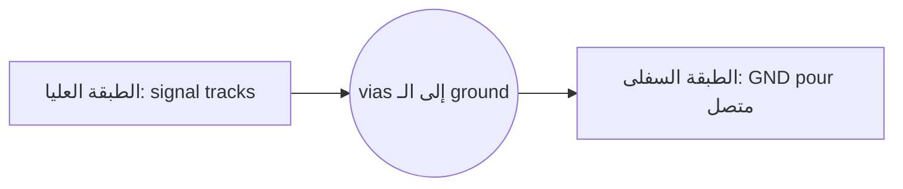

# التوصيل (Routing): الـ tracks والـ vias والـ ground

الآن حوّل كل خط ratsnest إلى نحاس. اضغط **X** لتبدأ track من pad، وانقر لعمل زوايا، وانتهِ على الـ pad الهدف. وKiCad يبقي الـ tracks على مسافة آمنة من كل شيء آخر تلقائيًا.

## عرض الـ track

الـ tracks التي تحمل current أكبر يجب أن تكون أعرض، وإلا تسخن. والمعيار IPC-2221 يعطي معادلة للعرض الأدنى. وأداة KiCad ‏**Calculator Tools → Track Width** تحسبها لك؛ وهذه هي بـ Python لترى ما الذي يحددها:

```python
def track_width_mm(current_a, temp_rise_c=10, copper_oz=1.0, outer=True):
    k = 0.048 if outer else 0.024
    area_mils2 = (current_a / (k * temp_rise_c ** 0.44)) ** (1 / 0.725)
    thickness_mils = 1.378 * copper_oz
    return area_mils2 / thickness_mils * 0.0254

for amps in [0.1, 0.5, 1, 2, 3]:
    print(f"{amps:>4} A -> at least {track_width_mm(amps):.2f} mm")
```

```output
 0.1 A -> at least 0.01 mm
 0.5 A -> at least 0.12 mm
   1 A -> at least 0.30 mm
   2 A -> at least 0.78 mm
   3 A -> at least 1.37 mm
```

قيم افتراضية عملية للـ boards الصغيرة:

- **الإشارات**: ‏0.25 mm ‏(لا current حقيقي).
- **الكهرباء** حتى حوالي 1 A: ‏0.5 mm أو أكثر.
- الأعرض مجاني عندما توجد مساحة: استخدمه للكهرباء والـ ground.

اضبطها كـ **net classes** ‏(Board Setup → Net Classes): ‏class اسمه "Power" بـ tracks عرضها 0.5 mm للـ +9V والـ GND، والافتراضي 0.25 mm لكل شيء آخر. وحينها يختار KiCad العرض الصحيح وأنت توصّل.

## عادات توصيل جيدة

- وصّل **الكهرباء والـ ground أولًا**، ثم التوصيلات الحساسة أو القصيرة، ثم الباقي.
- استخدم **زوايا 45°**، لا 90° (اضغط `/` أثناء التوصيل لتغيير نوع الزاوية). فهي أقصر وأنظف شكلًا.
- في الـ boards ذات الطبقتين، أسلوب شائع: الطبقة العليا tracks أفقية في أغلبها، والسفلى رأسية في أغلبها، تتصل بـ **vias** حيث يلزم (اضغط **V** أثناء التوصيل لوضع via وتغيير الطبقة).
- اجعل الحلقة من الـ decoupling capacitor إلى الـ chip **قصيرة**: من pad الـ capacitor إلى pin الـ VCC للـ chip، ومن ground الـ capacitor إلى pin الـ GND للـ chip، بأقصر طريق ممكن.

## الـ Ground pour

بدل توصيل كل توصيلة ground كـ track، املأ المساحة الفارغة على الطبقة السفلى (أو الطبقتين) بنحاس متصل بالـ GND: ‏**ground pour** ‏(zone).

1. اختر طبقة **B.Cu**، ثم **Place → Zone** ‏(Ctrl+Shift+Z).
2. اختر الـ net المسمى **GND**، وارسم الـ zone حول الـ board كله.
3. اضغط **B** لملء الـ zones. وكل pad للـ GND على هذه الطبقة يتصل تلقائيًا.



الفوائد: توصيل أقل، وضوضاء أقل، ومسار رجوع قصير لكل إشارة، وتوزيع أفضل للحرارة. وأضف بعض الـ vias الإضافية التي تربط مساحات الـ ground العليا والسفلى ("stitching") لكي لا تبقى جزيرة نحاس عائمة.

## الـ Thermal reliefs

الـ pads المتصلة بـ ground pour تأخذ أذرعًا صغيرة بدل توصيل كامل: ‏**thermal reliefs**. وبدونها، تمتص مساحة النحاس الكبيرة حرارة الكاوية ولا يتكون اللحام. وKiCad يضيفها افتراضيًا؛ اتركها.

## عندما تتعثر

لو لم يستطع track المرور: انقل جزءًا أو دوّره، أو انتقل للطبقة الأخرى بـ via، أو التف حوله. ولو تعثرت tracks كثيرة، ارجع إلى وضع الأجزاء: مشاكل التوصيل غالبًا هي مشاكل وضع.

## الخلاصة

- وصّل بـ X؛ واجعل عرض الـ tracks حسب الـ current ‏(0.25 mm للإشارات، و0.5 mm+ للكهرباء) باستخدام الـ net classes.
- زوايا 45°، وvias لتغيير الطبقات، وحلقات decoupling قصيرة، والكهرباء والـ ground أولًا.
- املأ GND pour على الطبقة السفلى (B تملأ الـ zones)؛ واترك الـ thermal reliefs؛ وأصلح التعثر بإعادة الوضع.

## فيديوهات اختيارية

الدرس أعلاه كامل وحده. هذه الفيديوهات للتعمق إن كنت تحب التعلم بالمشاهدة. الفيديوهات المكتوب بجانبها (بالإنجليزية) يمكنك تشغيل الترجمة لها (**CC**)، ثم **الإعدادات ← الترجمة ← ترجمة تلقائية ← العربية**.

**KiCad 9.0 getting started, part 6: laying out your first PCB (DigiKey) (بالإنجليزية)**

https://www.youtube.com/watch?v=zdieFtrvjew

**2-layer PCB design tips (Phil's Lab) (بالإنجليزية)**

https://www.youtube.com/watch?v=M6_an34wQJk
