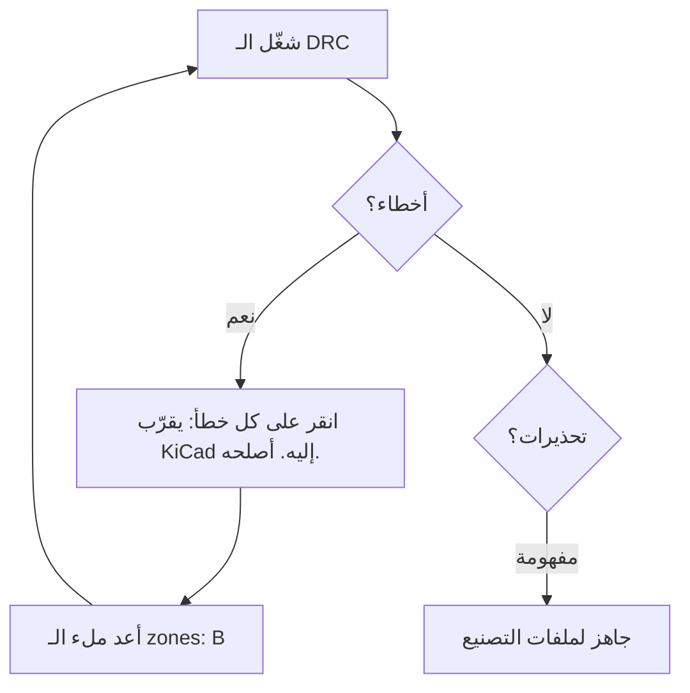

# الـ Design rules والـ DRC

لكل مصنع PCB حدود: أرفع track يستطيع صنعه، وأقرب مسافة بين trackين، وأصغر ثقب يستطيع ثقبه. صمم داخل هذه الحدود وسترجع إليك الـ boards سليمة.

## حدود معتادة للـ boards القياسية الرخيصة

| القاعدة | الحد القياسي المعتاد | اختيار آمن للمبتدئين |
|---|---|---|
| أقل عرض track | ‏0.127 mm ‏(5 mil) | من 0.2 إلى 0.25 mm |
| أقل clearance ‏(بين trackين) | ‏0.127 mm | ‏0.2 mm |
| أقل ثقب via | ‏0.3 mm | ثقب 0.4 mm وpad ‏0.8 mm |
| أقل حجم ثقب | ‏0.3 mm | رِجل الجزء + 0.2 إلى 0.4 mm |
| من النحاس إلى حافة الـ board | ‏0.3 mm | ‏0.5 mm |
| ارتفاع كتابة الـ silkscreen | من 0.8 إلى 1 mm | ‏1 mm |

هذه تختلف بين المصانع وتتغير مع الوقت. وقبل الطلب، ابحث عن صفحة **capabilities** للمصنع الذي اخترته واستخدم أرقامه. (الـ "mil" جزء من ألف من البوصة: ‏0.0254 mm.)

## ضبط القواعد في KiCad

**File → Board Setup → Design Rules → Constraints**: أدخل أقل عرض track، والـ clearance، وحجم الـ via، وحجم الثقب. وبعض المصانع تنشر ملف قواعد جاهزًا لـ KiCad أو board template تستطيع استيراده. وKiCad 10 فيه أيضًا محرر رسومي للقواعد المخصصة، مثلًا "اترك 2 mm بين جزء كهرباء البيت في الـ board وجزء الجهد المنخفض".

## تشغيل الـ DRC

**Inspect → Design Rules Checker** ‏(DRC) يقارن الـ board بالقواعد وبالـ schematic. ويبلغ عن:

- **Unrouted nets**: خط ratsnest نسيته.
- **Clearance violations**: نحاس قريب جدًا.
- **Track width** أقل من الحد الأدنى.
- **Courtyard overlaps**: أجزاء قريبة جدًا على التجميع.
- **Silkscreen over pads**: كتابة ستنقطع.
- **الـ schematic والـ board غير متزامنين**: غيّرت الـ schematic ولم تحدّث الـ PCB ‏(F8).

أعد ملء الـ zones ‏(**B**) قبل كل DRC: الـ ground pour القديم قد يخفي أخطاء أو يسببها.

## فحص بشري أخير

الـ DRC يكتشف كسر القواعد، لا أخطاء التصميم. وقبل الطلب، افحص بنفسك:

1. **اطبع الـ board بمقاس 1:1 على ورق** واضغط الأجزاء الحقيقية عليه. الـ footprints الخطأ تظهر فورًا.
2. الـ pin رقم 1 لكل chip، وpolarity كل LED وdiode و electrolytic capacitor.
3. الـ connectors: هل ترتيب + / − هو ما يتوقعه الكابل أو البطارية؟
4. كل chip له decoupling capacitor قريب من pin الكهرباء.
5. ثقوب التثبيت تطابق العلبة.
6. اسم الـ board وإصداره على الـ silkscreen.

عشر دقائق هنا توفر أسبوعين من انتظار boards لا تعمل.

## الخلاصة

- المصانع تنشر حدودها؛ اضبطها في Board Setup بقيم آمنة (tracks وclearances من 0.2 إلى 0.25 mm).
- شغّل الـ DRC حتى يصبح نظيفًا، مع إعادة ملء الـ zones أولًا؛ وأصلح عدم التزامن بـ F8.
- افحص بنفسك: طباعة 1:1، والـ polarities، والـ pin رقم 1، والـ connectors، والـ decoupling.

## فيديوهات اختيارية

الدرس أعلاه كامل وحده. هذه الفيديوهات للتعمق إن كنت تحب التعلم بالمشاهدة. الفيديوهات المكتوب بجانبها (بالإنجليزية) يمكنك تشغيل الترجمة لها (**CC**)، ثم **الإعدادات ← الترجمة ← ترجمة تلقائية ← العربية**.

**2-layer PCB design tips (Phil's Lab) (بالإنجليزية)**

https://www.youtube.com/watch?v=M6_an34wQJk
