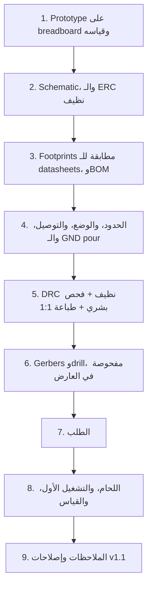

# مشروع: الـ LED flasher board الخاص بك من البداية للنهاية

حان وقت أن تقطع الرحلة كاملة بنفسك مع الـ 555 flasher، ثم board ثانٍ من اختيارك.

## قائمة الخطوات

اعمل عليها بالترتيب، وعلّم كل خطوة. إنها نفس القائمة التي يستخدمها المحترفون، لكن أقصر.

### ‏1. الـ Prototype

ابنِ الـ flasher من كورس الإلكترونيات على breadboard، مع R1 = 1 kΩ وR2 = 68 kΩ وC1 = 10 µF. قِس معدل الوميض. وقرر كيف ستشغّله: ‏clip لبطارية 9 V أو connector ‏USB ‏5 V ‏(الـ 555 يعمل من 4.5 إلى 16 V).

### ‏2. الـ Schematic

الـ symbols، والأسلاك، والـ power symbols، والـ PWR_FLAGs، والـ decoupling capacitor، والترقيم، والقيم، والـ ERC نظيف. وأضف LED ثانيًا على المخرج عبر resistor خاص به، ليبدو الـ board أجمل.

### ‏3. الـ Footprints والـ BOM

‏0805 للـ resistors والـ capacitors الصغيرة، وradial للـ electrolytic، وDIP-8 أو SOIC-8 للـ 555، و header بـ pinين أو connector ‏USB للكهرباء. طابق كل واحد مع الـ datasheet الخاص به. واصنع الـ BOM.

### ‏4. الـ Layout

- ‏board حوالي 35 × 25 mm، بأركان مستديرة، وثقبا تثبيت M3.
- ‏connector الكهرباء على حافة؛ والـ LEDs حيث تُرى.
- ‏C3 ‏(100 nF) بجوار الـ pin ‏8 للـ 555 مباشرة.
- tracks الكهرباء 0.5 mm، والإشارات 0.25 mm؛ وGND pour على الطبقة السفلى.
- الـ Silkscreen: ‏+ و−، وpolarity الـ LED، واسم الـ board، والإصدار، والتاريخ، واسمك.

### ‏5. الفحوص

‏DRC نظيف، والـ 3D view يبدو صحيحًا، والطباعة تطابق الأجزاء الحقيقية.

### ‏6 و7. الملفات والطلب

‏Gerbers وdrill files، مضغوطة ومفحوصة في الـ Gerber viewer. اطلب 5 boards.

### ‏8. البناء والاختبار

الحم الأجزاء الأقل ارتفاعًا أولًا، وافحص، وتحقق من الـ shorts، وشغّل بحد current، وقِس VCC ومعدل الوميض، واملأ جدول القياسات.

### ‏9. الملاحظات

اكتب ما ستغيّره. حتى الـ board الذي يعمل غالبًا له قائمة v1.1: تسمية في مكان أفضل، أو pad أكبر، أو connector مختلف.

## الـ board الثاني

اختر واحدًا وصممه بنفس الطريقة:

1. **اللمبة الليلية** من كورس الإلكترونيات: ‏LDR وpotentiometer وtransistor وثلاثة LEDs.
2. **لمبة مكتب LED تعمل بالـ USB** مع MOSFET وزر.
3. **Breakout board**: ضع chip ‏sensor صغيرًا من نوع SMD على board بـ pins ‏2.54 mm، لتستطيع استخدامه على breadboard.

## مشاركة التصميم

ضع الـ KiCad project والـ Gerbers والـ BOM والصور في مستودع GitHub مع README قصير. ويستطيع الآخرون طلب الـ board الخاص بك مباشرة من ملفاتك، وهي إضافة قوية للـ portfolio.

## إلى أين بعد ذلك

التالي في مسار الإلكترونيات: **تصميم PCB لـ Microcontroller**، حيث تصمم board كاملًا حول ATmega328P ‏(الـ chip الموجود في Arduino Uno)، مع كهرباء USB، وheaders للبرمجة، والـ sensors الخاصة بك، ثم تبرمجه.

## الخلاصة

- اتبع القائمة: ‏prototype، ‏schematic، ‏footprints، ‏layout، فحوص، ملفات، طلب، بناء، ملاحظات.
- صمم board ثانيًا بنفسك ليثبت الأسلوب.
- شارك الـ project ‏(ملفات KiCad والـ Gerbers والـ BOM والـ README) لكي يستطيع أي أحد بناءه.

## فيديوهات اختيارية

الدرس أعلاه كامل وحده. هذه الفيديوهات للتعمق إن كنت تحب التعلم بالمشاهدة. الفيديوهات المكتوب بجانبها (بالإنجليزية) يمكنك تشغيل الترجمة لها (**CC**)، ثم **الإعدادات ← الترجمة ← ترجمة تلقائية ← العربية**.

**KiCad 9.0 getting started, part 6: laying out your first PCB (DigiKey) (بالإنجليزية)**

https://www.youtube.com/watch?v=zdieFtrvjew

**Astable 555 timer (Ben Eater) (بالإنجليزية)**

https://www.youtube.com/watch?v=kRlSFm519Bo
