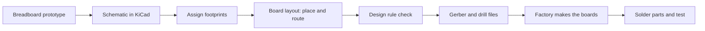

# What a PCB is

A **printed circuit board** (PCB) is the green (or blue, black, red) board inside almost every electronic device. It holds the parts and connects them with copper tracks instead of loose wires. Breadboards are for trying ideas; PCBs are for things that last, fit in a case and can be made by the hundred.

This course takes you from a breadboard circuit to a real board you order from a factory, using **KiCad**, a free, professional, open-source design suite. You should know basic electronics first (the *Electronics basics* course, or similar).

## Inside a board

| Layer | What it is | Why |
|---|---|---|
| **FR-4 core** | fibreglass and epoxy, usually 1.6 mm thick | the stiff base |
| **Copper** | thin copper sheets (35 µm, "1 oz") on one or both sides | the "wires": tracks, pads, ground areas |
| **Solder mask** | the coloured coating | insulates the copper and stops solder spreading |
| **Silkscreen** | white printing | part names (R1, C3), outlines, labels, your logo |

Small boards usually have **2 copper layers** (top and bottom). Complex boards (phones, computers) have 4 to 12 or more, with layers inside.

## The words you'll use every day

- **Track** (trace): a copper line connecting two points.
- **Pad**: exposed copper where a part's pin is soldered.
- **Via**: a small plated hole connecting a track on one layer to another layer.
- **Footprint**: the pattern of pads (and outline) for one part, matching its real pins.
- **THT** (through-hole): parts with legs through holes, easy to hand-solder.
- **SMD/SMT** (surface mount): small parts soldered onto pads on the surface; most modern boards use them.
- **Net**: a set of pins that must all be connected (for example every GND pin).
- **Ground plane** (pour): a large copper area connected to ground.

## From idea to board

1. **Schematic**: draw the circuit with symbols. This defines **what** connects to what.
2. **Footprints**: choose the physical package for every part.
3. **Layout**: place the footprints on a board shape and draw the copper tracks. This defines **where**.
4. **Checks**: let KiCad find mistakes (unconnected pins, tracks too close).
5. **Manufacturing files**: Gerber files describe each layer; a drill file lists the holes.
6. **Order**: upload them to a PCB maker. Small orders of 5 or 10 boards are cheap and arrive in a week or two.
7. **Assemble and test**: solder the parts and check the board works.

## Why bother?

- **Reliability**: no loose jumper wires; it works the same every time you pick it up.
- **Size**: SMD parts on a PCB take a fraction of the breadboard's space.
- **Repeatability**: order 100 identical boards.
- **Professional skill**: PCB design is a core job skill in hardware, robotics, IoT and embedded systems.

## Summary

- A PCB is layers of FR-4, copper, solder mask and silkscreen; tracks, pads and vias replace wires.
- Schematic (what connects) → footprints → layout (where) → checks → Gerbers → factory.
- KiCad is free and professional; this course uses it from start to finish.

## Optional videos

The lesson above is complete on its own. These videos go deeper, if you like learning by watching.

**An intro to KiCad, part 1: how PCBs are made (DigiKey)**

https://www.youtube.com/watch?v=vaCVh2SAZY4
