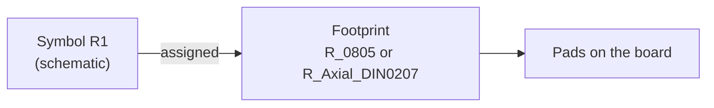

# Getting started with KiCad

## Install

Download KiCad from **kicad.org** (Windows, macOS, Linux). This course uses **KiCad 10**; KiCad 9 works almost the same. The download is large because it includes thousands of ready-made symbols, footprints and 3D models.

On Linux you can also use your distribution's package or the Flatpak from Flathub.

## The project

Open KiCad and choose **File → New Project**. Give it a name like `led-flasher`. KiCad creates a folder with:

```text
led-flasher/
  led-flasher.kicad_pro    project settings
  led-flasher.kicad_sch    the schematic
  led-flasher.kicad_pcb    the board
```

Keep everything for one board in its own folder, and put it under **git** (it's all text files), so you can always go back.

## The main tools

From the project window you open the editors:

| Tool | What you do there |
|---|---|
| **Schematic Editor** | draw the circuit with symbols and wires |
| **Symbol Editor** | make a symbol for a part that isn't in the library |
| **PCB Editor** | place footprints and route copper tracks |
| **Footprint Editor** | make or edit footprints |
| **Gerber Viewer** | check the files you'll send to the factory |
| **Calculator Tools** | track widths, resistor values, regulators and more |

## Symbols vs footprints

This difference trips up every beginner:

- A **symbol** is the drawing in the schematic: a resistor zigzag with two pins. It says nothing about size.
- A **footprint** is the copper pattern on the board: two pads 7.6 mm apart for a through-hole resistor, or two tiny pads for an 0603 SMD resistor.

One symbol (a resistor) can use many footprints. You connect the two in the "assign footprints" step, and KiCad keeps them linked: change the schematic, then update the board.



## Moving around

The keyboard shortcuts you'll use constantly (in both editors):

| Key | Action |
|---|---|
| A | add a symbol (schematic) |
| W | draw a wire (schematic) |
| X | route a track (PCB) |
| M / G | move / grab (keeps wires attached) |
| R | rotate |
| E | edit properties of the item under the mouse |
| Delete | delete |
| Ctrl+Z | undo |
| Mouse wheel | zoom; middle-drag or arrow keys to pan |

Press **Ctrl+F1** (or **?**) in any editor for the full list.

## Settings worth changing first

- **Preferences → Common → Units**: millimetres (most factories and datasheets use mm).
- In the PCB Editor, **File → Board Setup → Design Rules**: you'll set these from your factory's limits in module 4.
- Turn on **autosave** in Preferences.

## Libraries

KiCad's built-in libraries cover most common parts: resistors, capacitors, LEDs, connectors, popular chips. When a part is missing:

1. Search the online services that provide KiCad symbols and footprints for specific part numbers (for example the part pages of SnapEDA, Ultra Librarian or the LCSC/JLCPCB parts site).
2. Or draw it yourself in the Symbol and Footprint editors, using the **package drawing** in the part's datasheet. Module 2 shows how.

Always check a downloaded footprint against the datasheet's dimensions before ordering boards.

## Summary

- Install KiCad 10 from kicad.org; each board is a project folder (keep it in git).
- Schematic Editor for symbols and wires, PCB Editor for footprints and tracks.
- Symbols say what connects; footprints are the physical pads; you link them before layout.

## Optional videos

The lesson above is complete on its own. These videos go deeper, if you like learning by watching.

**KiCad 9.0 getting started, part 1: intro and download (DigiKey)**

https://www.youtube.com/watch?v=0WCi1rhueH4
